# design-system

Shared shadcn/ui component registry and design tokens, consumed by `myargus`,
`atto1`, `argus`, `homelab` and `quick-capture` via the shadcn CLI (`slate-reader`
vendors LinkPill; `budget` is migrating — see [Consumers](#consumers)). This
repo is not a
buildable package — it's a plain GitHub-hosted registry: a `registry.json`
manifest plus the source files it points to. The shadcn CLI reads
`registry.json` directly from GitHub, resolves the referenced files, and
copies them into the consuming project. There's no publish step.

## Quick start

For working **in** this repo. To use the registry from an app, skip to
[Consuming this registry](#consuming-this-registry-from-another-project).

**Prerequisites**

- Node 22 or later (CI runs 22) and pnpm 12.13.0, the `packageManager` pin
  (`corepack enable` picks it up). npm is not used here.
- `git`, `bash` and `jq` (the links and design-check scripts use them).
- Network: `npx` fetches the pinned `shadcn` and `impeccable` on first use.
- Chromium, only for `pnpm gate:geometry` and the `docs/*` demo checks:
  `pnpm exec playwright-core install chromium`. The gate can use another
  browser through `GATE_CHROMIUM`; the demo scripts read the headless shell from
  `~/.cache/ms-playwright/` (Linux), so they need Playwright's own install.

**Setup**

```bash
git clone https://github.com/deanjstone/design-system.git && cd design-system
pnpm install --frozen-lockfile
```

**Commands**

| Command | Does |
|---|---|
| `pnpm test` | Vitest: renders registry sources in jsdom (`test/`) |
| `pnpm lint` | oxlint, type-aware |
| `pnpm check` | `test`, impeccable detector, `r/` drift, `lint`: what CI runs, in one command; run before every push |
| `pnpm build:theme` | Regenerates `theme/tokens.css`, `registry.json` and `r/` from `theme/themes.json` |
| `npx shadcn@4.19.1 build --output ./r` | Regenerates `r/` alone after a source or `registry.json` edit |
| `pnpm gate:geometry` | Browser check of safe areas and curves; see [Curve-geometry gate](#curve-geometry-gate) |
| `node docs/<demo>/smoke-check.mjs` | Builds a demo and checks it in headless Chromium: `data`, `form-inputs`, `layout`, `page-transition`; `docs/card-list/screenshots.mjs`, `docs/issue-row/screenshots.mjs`, `docs/filter-builder/screenshots.mjs`, `docs/grouped-list/screenshots.mjs` and `docs/ds-theme/screenshots.mjs` do the same in headless WebKit; `docs/menus/keyboard-check.mjs` and `docs/graph-3d/{measure,inspect}.mjs` likewise |

There is nothing to run as a server: the registry is files. A demo script builds
and serves its page for the length of its run and then stops.

**Deploy.** Nothing is deployed to a host. A new version is published when the
owner promotes a `main` commit to the `deploy` branch (`scripts/promote.sh <sha>`,
or Approve on the ops hub card), which runs the `Release` workflow: tests first, then a
`vX.Y.Z` tag, GitHub release and CHANGELOG entry. A push to `main` publishes
nothing. Full flow, rollback and first-time setup: [docs/deploy-branch.md](docs/deploy-branch.md);
see [Versioning](#versioning).

**Configuration.** The registry itself reads no environment. These are optional
overrides for the scripts (names only; no value is stored in the repo):

| Variable | Read by | Meaning |
|---|---|---|
| `GATE_CHROMIUM` | `pnpm gate:geometry` | Path to a Chromium when Playwright's is not installed |
| `GATE_REGISTRY`, `GATE_THEME` | `pnpm gate:geometry` | Check another checkout's `registry/` or `theme/` |
| `GATE_OUT` | `pnpm gate:geometry` | Where the harness page is built (default `node_modules/.cache/geometry-gate/dist`); screenshots always go to `geometry-gate-out/` |
| `PROMOTE_REMOTE` | `scripts/promote.sh` | Remote to push `deploy` to (default `origin`) |
| `LINK_CHECK_MODE` | `scripts/link-check.sh` | `report` (default) or `block` |
| `CLOUDFLARE_API_TOKEN`, `CLOUDFLARE_ACCOUNT_ID` | `scripts/links/cf-drift.mjs` | Required; read-only token. `CLOUDFLARE_ZONE_ID` and `CLOUDFLARE_TUNNEL_ID` are optional |

**Where to read next:** [DESIGN.md](DESIGN.md) (tokens, themes, blocks),
[GLOSSARY.md](GLOSSARY.md), [CONTRIBUTING.md](CONTRIBUTING.md) (commit types),
[docs/adr/](docs/adr/), [docs/deploy-branch.md](docs/deploy-branch.md),
[docs/graph-3d/README.md](docs/graph-3d/README.md), and `AGENTS.md` for agents.

## Consumers

This list is how a registry change is checked for downstream breakage, so keep
it true. Pins are the `@design-system` alias version in each repo's
`components.json` on `main`, read on 2026-11-07. The alias is where the next
`add` will pull from; the code already in the repo is whatever was last pulled.

| Consumer | Path | Pin | Status |
|---|---|---|---|
| `argus` | `apps/email` | v3.18.0 | consuming |
| `argus` | `apps/ops-hub-web` | v3.18.0 | consuming ([argus#728](https://github.com/deanjstone/argus/issues/728)) |
| `argus` | `apps/watchtower` | v3.18.0 | consuming ([argus#674](https://github.com/deanjstone/argus/issues/674)) |
| `homelab` | `services/scan-app/web` | v3.1.0 | consuming ([homelab#181](https://github.com/deanjstone/homelab/issues/181)) |
| `atto1` | repo root | v3.1.0 | consuming |
| `quick-capture` | `web` | v3.1.0 | consuming (split out of `homelab` `services/quick-capture/web` in [homelab#228](https://github.com/deanjstone/homelab/issues/228)) |
| `myargus` | `apps/knowledge`, `apps/reader` | v3.18.0 | consuming ([myargus#296](https://github.com/deanjstone/myargus/issues/296)) |
| `myargus` | `apps/briefings` | v3.18.0 | consuming |
| `myargus` | `apps/shell` | v3.18.0 | consuming |
| `myargus` | `apps/stockade` | v3.18.0 | consuming ([myargus#295](https://github.com/deanjstone/myargus/issues/295)) |
| `slate-reader` | `apps/server` | v2.7.0 (vendored) | **LinkPill only**: `link-pill-core` and `link-pill-html` are copied in; no `@design-system` alias. The web UI is `apps/client` (Preact, no registry) ([slate-reader#17](https://github.com/deanjstone/slate-reader/issues/17)) |
| `budget` | `web` | none yet | **pending**: forked `components/ui`, no `components.json` ([budget#271](https://github.com/deanjstone/budget/issues/271)) |

Move a pending row to consuming only once a `components.json` with the alias
is on that repo's `main`.

## Structure

```
registry.json              root manifest — one entry per distributable item
registry/
  lib/utils.ts              re-exports cn() from the cn package
  lib/theme-preference.ts   theme + Light/Dark/System choice: cookie, localStorage, no-flash script
  lib/font-preference.ts    the font choice (default or Aspekta), kept apart from the theme: data-font, its own cookie, no-flash script
  fonts/                    the font-aspekta item: ds-fonts.css, install-ds-fonts.sh, and the original OFL font files and notices (fonts.json lists them)
  lib/nav-link.tsx          renderAnchor and the renderLink type the layout blocks share
  lib/link-pill-*.ts, .css  LinkPill core, HTML shell and styles
  lib/highlighter.tsx       Shiki loader behind use-highlighted-code
  lib/graph-3d-*.ts         graph-3d prop mapping and three.js engine (lazy-loaded)
  lib/filter-core.ts, url-state.ts  filter model and one-search-param URL state (filter-builder)
  lib/list-group-core.ts    grouping and display-settings model (grouped-list)
  lib/page-transition-core.ts  theme tokens to glimm band colours (page-transition, staged: not in registry.json yet)
  base-nova/ui/               66 listed base-nova components (Base UI, plus link-pill, graph-3d, chart, data-table) and the unlisted page-transition
  base-nova/hooks/            use-mobile (pulled by sidebar), use-highlighted-code (pulled by code-block), use-theme-preference, use-font-preference, use-filter-state, use-display-settings
  base-nova/blocks/           v3 layout blocks: app-shell, app-switcher, page-header, empty-page, settings-page, login, card-list, issue-row, filter-builder, grouped-list, file-diff
  design-check/             scripts and workflow of the design-check item (CI, not UI)
  app-html-head/            iPhone <head> tags snippet (app-html-head item)
  links/                    links.json, its schema, links.sh and the link-check script and workflow (ADR-0004)
  lib/links-core.ts, links.ts  URL builders, and the module generated from links.json
r/                         generated per-item output — what the r/ alias resolves
theme/tokens.css            same tokens as the "theme" item, as plain CSS
theme/themes.json           the six T3 themes (light + dark) behind both; see DESIGN.md Themes
test/                      Vitest suites, one per item, plus ones that pin the scripts and workflows
docs/                      ADRs, deploy-branch.md, and one demo plus browser check per feature area
scripts/geometry-gate/     the curve-geometry gate behind pnpm gate:geometry
scripts/release/           semantic-release plugin and helpers; scripts/promote.sh pushes deploy
scripts/theme/              extract-t3.mjs reads T3's sheet; build.mjs writes tokens.css and registry.json
scripts/links/              registry.mjs validates links.json, generate.mjs writes lib/links.ts, cf-drift.mjs diffs Cloudflare
```

## Consuming this registry from another project

A consumer needs a `components.json` first, then pulls items straight from
GitHub by address:

```bash
npx shadcn init            # once per project, if there is no components.json
npx shadcn add deanjstone/design-system/theme
npx shadcn add deanjstone/design-system/button
```

This uses shadcn's native GitHub-registry support: any public repo with a
root `registry.json` is installable directly via `<owner>/<repo>/<item>`.
No `registries` entry in `components.json` is needed — see the warning
below for why you should not add one.

**`shadcn init` is a prerequisite, not an optional step.** `shadcn add`
cannot write anything without a `components.json`; run without one it stops
and prompts to create the file. `init` is also interactive by default — it
asks for a component library and a preset with arrow-key menus that cannot
be driven non-interactively — so scripted setups need both flags:

```bash
npx shadcn init -b base -p nova -y --css-variables
```

`-b base` is the CLI's own default and is what this registry expects: its
components are Base UI (`@base-ui/react`), per
[ADR-0001](docs/adr/0001-switch-component-library-to-base-ui.md). Passing
`-b radix` or `-b aria` installs a component library the registry's
components do not import.

**Add the font import.** The `theme` item owns the typeface
([ADR-0002](docs/adr/0002-registry-owns-the-font-token.md)) and declares
`@fontsource-variable/ibm-plex-sans` as a dependency, so the package
installs — but an `@import` has to precede every other rule in a stylesheet
and cannot be injected from a registry `css` block. Add it yourself, once,
at the top of your CSS entry:

```css
@import "@fontsource-variable/ibm-plex-sans";
```

Note the preset (`-p nova` above) also brings its own typeface and base
stylesheet. Pulling the `theme` item overrides `--font-sans`, so Plex wins,
but the preset's font package stays installed unless you remove it.

Components import `cn` from the `cn` package (`import { cn } from "cn"`),
which replaced `clsx` and `tailwind-merge` upstream in September 2026, and
declare it as a dependency (`cn@^0.5.0`, pinned to its minor because the
package is pre-1.0). Nothing in the registry depends on `clsx` or
`tailwind-merge` any more. The `utils` item stays and writes
`lib/utils.ts` as `export { cn } from "cn"`, so your own code that imports
`@/lib/utils` keeps working. Components no longer pull `utils` in, so adding
one leaves your `lib/utils.ts` alone.

**Moving a consumer that pinned an earlier tag:** pull items from this release,
then run upstream's migration, which moves the project from `clsx` and
`tailwind-merge` to `cn`:

```bash
npx shadcn@latest migrate cn
```

If your `lib/utils.ts` carries a custom `extendTailwindMerge` config, do not
re-pull `utils` over it; port the config to `cn/config` first (see the
[cn README](https://github.com/shadcn-ui/cn#custom-themes)).

(Do **not** add this repo under `components.json`'s `registries` field with
a bare `registry.json` URL — that field requires a `{name}`-templated
per-item endpoint, e.g. `.../{name}.json`, which this repo doesn't publish.
A bare-URL entry fails the CLI's config validation and breaks every shadcn
command in the consumer, not just registry pulls. If a stable alias is ever
needed, it belongs under `registries` as `"@design-system": {"url":
"https://raw.githubusercontent.com/deanjstone/design-system/main/r/{name}.json"}`
pointing at real per-item output from `shadcn build` — not the root
`registry.json`.)

The CLI writes files into the consumer's own `aliases.ui` / `aliases.lib`
paths — components become that project's code, editable locally like any
other shadcn component. Updates are pulled explicitly, not auto-synced.

**Gotcha for Vite consumers with a TS solution-style `tsconfig.json`**
(references-only, with the real `@/*` alias living in a referenced
`tsconfig.app.json`): the shadcn CLI only reads the root `tsconfig.json`
for alias resolution, not files it references. If the root config has no
`paths`, the CLI won't error — it silently writes files into a literal
`./@/` directory instead of `./src/`. Fix is adding `baseUrl`/`paths`
directly to the root `tsconfig.json` (redundant with the referenced
config, but required for the CLI to find it).

**Gotcha for Vite consumers using the default React ESLint config:**
`button` exports `buttonVariants` alongside the component, which
`react-refresh/only-export-components` rejects. That is upstream shadcn's
convention across the whole ecosystem, so the fix belongs in the consumer's
lint config rather than in the component — editing the vendored file would
be overwritten by the next `shadcn add`:

```js
{
  files: ['src/components/ui/**/*.{ts,tsx}'],
  rules: { 'react-refresh/only-export-components': 'off' },
}
```

## Versioning

Releases are cut automatically by semantic-release from Conventional
Commits, but only when the owner promotes a `main` commit to the `deploy` branch
([docs/deploy-branch.md](docs/deploy-branch.md)). A push to `main` runs checks
and releases nothing; there is no manual tagging step. The `Release` workflow
(`.github/workflows/release.yml`) runs on the push to `deploy`: a
`Test before release (component tests, design detector, registry drift, curve geometry gate, lint)` job first
(every step of `scripts/check.sh` plus the geometry gate, so nothing reaches `main` that `pnpm check` would reject),
then `Release`, which needs it, so a red test publishes no version. A `fix:` bumps the
patch, a `feat:` the minor, and a `BREAKING CHANGE:` footer the major. The
analyzer here (`conventional-changelog-angular` 8.3.1) does not read a `!` in
the subject, so a `feat!:` with no footer releases nothing; write both. Every release gets a `vX.Y.Z` tag, a GitHub release, and a CHANGELOG
entry.

An unpinned `shadcn add deanjstone/design-system/<item>` pulls whatever
`main` holds at that moment, so an `add` re-run can pull a breaking change
without warning. It has happened twice: `v2.0.0` replaced Radix with Base UI
([ADR-0001](docs/adr/0001-switch-component-library-to-base-ui.md)) and
changed the component API from `asChild` to a `render` prop; `v2.1.0` took
ownership of the typeface
([ADR-0002](docs/adr/0002-registry-owns-the-font-token.md)), which changes
how every consumer looks.

### Pinning to a release

**From the release that ships design-system#65, a tag pins its dependencies
too.** Every in-repo `registryDependencies` entry in a tagged `registry.json`
and `r/*.json` carries that tag's ref, for example
`deanjstone/design-system/button#v4.0.0`, so shadcn fetches each dependency
from the same tag as the item you named. shadcn does not carry a ref across
dependencies on its own: "Refs are not inherited across dependencies. If a
dependency should be pinned, include its own ref." ([GitHub
Registries](https://ui.shadcn.com/docs/registry/github), read 2026-10-08), so
the release writes the ref into each entry. `main` keeps the unversioned form
(`deanjstone/design-system/<name>`), so an unpinned install still floats.

**Older tags do not.** Before that release, a pin fixed only the item you
named: every `registryDependencies` entry was an unversioned address and
resolved from `main`. If you pin to an older tag, read the "In practice"
paragraph below. Entries from other registries are never stamped. Only `theme`,
`utils`, `use-mobile`, `highlighter`, `link-pill-core` and `link-pill-css` have no
registry dependencies. Almost every other item depends on at least `utils`.

**What the release does.** semantic-release's `prepare` step runs
`scripts/release/semantic-release-pin.mjs` after the changelog and version files
are written (the plugin commits them itself, on top of the promoted SHA). It stamps
`#<tag>` into `registry.json`, rebuilds `r/` with `shadcn build`, fails the
release if any in-repo entry is left without exactly that ref, and commits the
result. The tag points at that commit. A second commit on `main` restores the
unversioned `registry.json` and `r/`, so `main`'s tree is the release commit's
tree. The tag stays reachable from `main`, which semantic-release needs to
find the last release. A commit cannot contain its own SHA, so the tag name is
the ref. Tags are immutable by convention, which is what makes that safe.

**When `main` moves during a release.** Direct pushes can land while a Release
run is in flight. The run starts from the tip of `deploy`, the promoted SHA, so
a newer `main` is never released early. It runs
`scripts/release/release-with-retry.sh`, and redoes the release up to 3 times if
semantic-release reports the branch is behind or a release push is rejected as
a non-fast-forward; each attempt first resets the checkout to `origin/deploy`.
The version bump is merged into whatever `main` holds when it lands.
Three failures fail the job with an `::error::` line. A rejection of the pin
plugin's last push, which comes after the release commit has reached `main`,
leaves a second release commit and a duplicate CHANGELOG section for the same
version after the redo; the tag and `r/` pin are still made once.
The `Registry output current` check runs on `main` and pull requests only, so
it never sees the stamped form.

**Option 1: a `#ref` on the item address (preferred).** shadcn 4.x accepts
a branch, tag or commit SHA after `#`:

```bash
npx shadcn add deanjstone/design-system/button#v3.0.0
npx shadcn add deanjstone/design-system/button#645db462137cf60b416d8ee4fc753146c5e0b51d
```

A tag works for every release. A full 40-character SHA is the most
reproducible ref and skips the CLI's `git ls-remote` lookup. Both work
without a `components.json` `registries` entry.

**Option 2: the `r/` alias.** `r/` holds per-item output from
`shadcn build`, one self-contained JSON per item with the source inlined.
A tag includes `r/`, so a tagged raw URL serves the item exactly as it
shipped. Register the alias once in the consumer's `components.json`:

```json
{
  "registries": {
    "@design-system": {
      "url": "https://raw.githubusercontent.com/deanjstone/design-system/v3.0.0/r/{name}.json"
    }
  }
}
```

then add by alias:

```bash
npx shadcn add @design-system/theme @design-system/button
```

This is the `{name}`-templated endpoint the warning above refers to, the
thing a bare `registry.json` URL cannot be. `r/` exists from `v2.2.0`
onward.

**Which to use.** The two forms pin the same thing: the named item, at the
tag. Their dependency behaviour is identical. Use `#ref` by default. It is
the form shadcn documents, it needs no config, and it can name a commit
SHA. Use the alias when a project wants one place to set the version: it
upgrades every later `add` by bumping a single URL. Use the unpinned
shorthand only to track `main` on purpose.

**What this means in practice.** `shadcn add` copies source into the
consumer's repo, so the code you commit is the real pin. A later `add`
changes nothing until it runs. Review its diff the way you would review any
dependency upgrade. On a tag from the release that ships design-system#65 or
later, files pulled in as dependencies come from the same tag. A dependency
added to `main` after the tag is never installed by a tagged address. On an
older tag, dependencies come from `main`, and passing each one with its own
`#ref` in the same command does **not** work around that: the dependency's
`main` copy wins (see below). For a fully reproducible install from an older
tag, pin and add only leaf items (`theme`, `utils`, `use-mobile`), or inspect
the dependency files the CLI writes. A tooling script that reads
`registryDependencies` from a tagged build sees the `#ref` suffix.

Verified 2026-10-08 with `shadcn@4.21.4` against a tag from before the stamping
above, in a fresh Vite app with `init -b base -p nova`. Every `fetch` and `git` call the CLI made was logged
(design-system#59):

| Command | Named item from | Dependencies from |
|---|---|---|
| `add deanjstone/design-system/sidebar#v2.5.1` | `645db46` (the `v2.5.1` tag) | `main` HEAD, all 8 |
| `add deanjstone/design-system/button#645db46…` (full SHA) | that commit, no `ls-remote` for it | `utils` from `main` HEAD |
| `add @design-system/sidebar` (alias at `v2.5.1`) | `v2.5.1/r/sidebar.json` | `main` HEAD, all 8 |
| `add …/separator#v2.3.0` | `v2.3.0` | — |
| `add …/sidebar#v2.5.1 …/separator#v2.3.0` (either order) | — | `separator` from `main` |

Tags before `v2.5.0` behave worse. Their dependencies are bare names such
as `utils`, which resolve to **upstream shadcn's** items, not this
registry's (design-system#57).

`r/` is generated. Rebuild it with `npx shadcn build --output ./r` whenever
`registry.json` or a source file changes. CI rebuilds it and fails on any
difference, because a stale `r/` would serve a tag's consumers older code
than the tag claims.

## LinkPill

Renders a Markdown link as a pill that shows what it points at. Four items,
no npm dependencies (see `GLOSSARY.md` for the terms and
[ADR-0003](docs/adr/0003-scheme-first-link-kind-detection.md) for how the
kind is detected):

| Item | Use it for |
|---|---|
| `link-pill-core` | `classify(href)`, per-kind attributes and the `Enricher` type. Pure and ES5-safe. |
| `link-pill-html` | `renderLinkPill(link, options) → string` for server-side renderers. Depends on the core only. |
| `link-pill` | The React shell: `LinkPill`, plus `LinkPillEnricherProvider`. |
| `link-pill-css` | The one stylesheet both shells use. Installs to `link-pill.css` at the project root (move it where you like) — import it once. |

```bash
npx shadcn add deanjstone/design-system/link-pill        # React
npx shadcn add deanjstone/design-system/link-pill-html   # HTML strings
```

```tsx
// React: use it as the Markdown renderer's anchor component.
<LinkPillEnricherProvider enrich={enrich}>
  <Markdown components={{ a: (props) => <LinkPill variant="chip" {...props} /> }} />
</LinkPillEnricherProvider>
```

```ts
// HTML, e.g. a marked renderer; `legacy: true` for Safari 9.
renderLinkPill({ href, label: text }, { variant: "inline", legacy: false })
```

- `variant` is `"inline"` (prose: glyph plus tinted underline, wraps) or
  `"chip"` (chat: tinted chip, label cut at about 24ch by CSS; the full label
  stays in the DOM as the accessible name and `title`).
- A pill renders at once from the href and link text. The optional
  **Enricher** (`(link) => Promise<{ label?, avatarUrl?, title? } | null>`)
  upgrades Mentions and URL Links afterwards; results are cached per href, and
  a `null` or a failure leaves the pill as rendered (a failure is logged with
  `console.error`). The HTML shell is synchronous, so it takes an
  already-resolved `enrichment` option instead.
- A chip is followed by a word joiner (U+2060) so the punctuation after it
  cannot be stranded on its own line.
- Hrefs of kind None render as an ordinary `<a>`. A `javascript:`, `data:` or
  `vbscript:` href, and the streaming placeholder `streamdown:incomplete-link`,
  render the label as text. The HTML shell escapes every label and attribute,
  but still sanitise its output after rendering.
- Link kinds that need allowlisting in a sanitiser: schemes `geo:` and
  `mention:`, plus the `link-pill*` classes, the `svg`, `path`, `img` and `span`
  elements and their `viewBox`, `d`, `aria-hidden` and `focusable` attributes.

## Agent-interface items

`trace`, `code-block` and `questionnaire` are shadcn's October 2026 agent-interface
components (see the [shadcn changelog](https://ui.shadcn.com/docs/changelog)),
in `base-nova` style with the upstream API unchanged. They complete the
Conversation set for an agent turn:

| Item | Use it for | Pulls in |
|---|---|---|
| `trace` | One line per agent step (reasoning, tool call, source, plan, subagent run), with `running`, `error` and `pending` states and nested, expandable detail | `collapsible`, `code-block` |
| `code-block` | Code, terminal output, logs and diffs: line numbers, wrap, highlighted lines, and `size="sm"` for tool output inside a `trace` | `button`, `use-highlighted-code` → `highlighter` (`shiki`) |
| `questionnaire` | Asks the person to clarify before the agent continues: single and multiple choice, freeform, skippable | `button`, `@shadcn/react@^0.3.1` |

```bash
npx shadcn add deanjstone/design-system/trace#v3.0.0
npx shadcn add deanjstone/design-system/code-block#v3.0.0
npx shadcn add deanjstone/design-system/questionnaire#v3.0.0
```

Syntax highlighting is optional and lives in `use-highlighted-code`; add
languages to the `languages` map in the copied `highlighter.tsx`. `trace`
declares `code-block` because a tool step's output belongs in one; it does not
import it. `shimmer` (the running title) and `scroll-fade-*` come from
`shadcn/tailwind.css`, which `shadcn init` already imports, as for
`attachment` and `message-scroller`.

**Consumers that should adopt them:** `argus` `apps/ops-hub-web`. Adoption is a follow-up issue per consumer, not part of
adding the items.

## Adding a new component

1. Add the source file(s) under `registry/base-nova/ui/` (or `registry/lib/`
   for non-UI code).
2. Add a matching entry to `registry.json` — `name`, `type`
   (`registry:ui` / `registry:lib` / `registry:hook`), `files`, and any
   `registryDependencies` / `dependencies`.

   A `registryDependencies` entry naming another item in this repo must use
   its full address, `deanjstone/design-system/<name>`. A bare name such as
   `button` means shadcn's built-in item, not ours, so the consumer silently
   gets upstream's copy (design-system#57). Write it without a ref: the
   release stamps `#<tag>` into tagged builds itself.

   Pin a pre-1.0 npm dependency to its minor, e.g. `@shadcn/react@^0.3.1`,
   so a re-run `shadcn add` cannot pull a breaking release.
3. Add its test under `test/`, run `pnpm check`, and commit straight to `main` in small
   Conventional Commits (this is a trunk repo: no branch, no PR). `main` is not a release:
   the owner promotes it to `deploy` ([docs/deploy-branch.md](docs/deploy-branch.md)).

## Themes

The `theme` item carries six themes (`default`, `t3-chat`, `grove`, `ocean`,
`ember`, `iris`), each in light and dark, selected by `data-theme` plus the
`dark` class; no attribute means Ocean. The `theme-preference` lib stores the
visitor's choice. Token map, selection rules and the pinned T3 source are in
[DESIGN.md](DESIGN.md#themes). After editing `theme/themes.json`, run
`pnpm build:theme` to regenerate `theme/tokens.css`, `registry.json` and `r/`.

### Optional DS theme and font

Two opt-ins sit beside the six themes. Neither changes anything for an app that does
not install them: the default theme, the default font and the default theme list are
as they were.

| Option | Item | Switch | Stored (per device) |
|---|---|---|---|
| DS look: tinted-neutral scale, hairline edges, sheen on raised surfaces, squircle corners (where the browser has `corner-shape`), recessed wells; light and dark | `theme-ds` | `data-theme="ds"` | `ds-theme` cookie and `localStorage`, with the other themes |
| Aspekta (UI) and Azeret Mono (code) | `font-aspekta` | `data-font="aspekta"` (no attribute for the default) | `ds-font` cookie and `localStorage`, separate from the theme |

To offer them in an app:

```bash
npx shadcn add deanjstone/design-system/theme-ds deanjstone/design-system/font-aspekta
npx shadcn add deanjstone/design-system/use-font-preference
bash scripts/install-ds-fonts.sh        # downloads the original font files into public/fonts/ds
```

then import the stylesheet once (`@import "./ds-fonts.css";`, from `src/` as `font-aspekta`
installs it), put `fontInitScript()` next to `themeInitScript()` in `<head>`, and pass the
choices to the settings page:

```tsx
const { preference, setTheme, setMode } = useThemePreference()
const { font, setFont } = useFontPreference()
<AppearanceSection preference={preference} onThemeChange={setTheme} onModeChange={setMode}
  themes={ALL_THEMES} font={font} onFontChange={setFont} />
```

Leave `themes` and `font` out and the section lists the six themes and no Font group.

**Fonts.** The files are SIL OFL 1.1 and are the unmodified originals from each font's own
repository (`ivodolenc/aspekta` at `@aspekta/fonts@2.100`, `displaay/Azeret` at a pinned
commit), listed with their sha256 in `registry/fonts/fonts.json`. Aspekta has a Reserved
Font Name, so they are never renamed, subsetted or converted. They are not in
`registry.json`: the shadcn CLI reads files as UTF-8 text and would corrupt a binary, so
`install-ds-fonts.sh` downloads them and checks each sha256 first (`DS_FONTS_SOURCE_DIR` copies
them from a checkout offline). The licence notices ship with the item, into `public/fonts/ds`.
The stylesheet's `src` urls assume `public/` is served from the site root.

Proof: `node docs/ds-theme/screenshots.mjs` (WebKit, 390 and 320 px, every theme, mode and
font, plus the settings flow and its persistence). Rationale:
[ADR-0005](docs/adr/0005-optional-ds-theme-and-font.md).

## Migrating from v2 to v3

v3.0.0 changes how every app looks once its `theme` item is re-added, so it is
a major. The registry shipped most of it in v2.12.0 by accident (a `feat:`
merge subject); v3.0.0 adds the layout blocks and marks the break. Nothing
changes in an app until it re-runs `shadcn add` against `#v3.0.0`.

```bash
npx shadcn add deanjstone/design-system/theme#v3.0.0 -o
npx shadcn add deanjstone/design-system/app-shell#v3.0.0
```

| Area | v2 | v3 | What to do |
|---|---|---|---|
| Themes | One chroma-zero palette | Six themes (`default`, `t3-chat`, `grove`, `ocean`, `ember`, `iris`), each light and dark; no `data-theme` means **Ocean** | Set `data-theme` on `<html>` to keep another palette; `-o` overwrites files the CLI wrote earlier, so diff any hand edits first |
| Type scale | Tailwind's sizes | T3's scale: `text-xs` is 13px/17px (was 12px/16px), `text-xl` 21px, `text-2xl` 26px; `text-2xs` and `text-3xs` are new | Swap `text-xs` for `text-2xs` where the old 12px is wanted |
| Glass tokens | none | `--glass-surface`, `--glass-fallback`, `--glass-blur`, `--glass-opacity`, `--glass-saturation`; `surface-glass`, `dialog-glass`, `dropdown-glass` utilities | Nothing, unless you want the glass recipe |
| Theme preference | Per-app | `theme-preference` lib (cookie `ds-theme` on a configurable parent domain, `localStorage` fallback, no-flash `themeInitScript()`) and the `use-theme-preference` hook | Put `themeInitScript()` in `<head>` |
| Layout blocks | none | `app-shell`, `app-switcher`, `page-header`, `empty-page`, `settings-page`, `login`, `card-list`, `issue-row`, `filter-builder`, `grouped-list`, `file-diff`, plus the `nav-link` lib | Optional; add the ones you want |
| Radius | `0.625rem` | `0.625rem`, unchanged | Nothing |

Rules for the blocks and the full token map are in
[DESIGN.md](DESIGN.md#layout-blocks). A pin on a consumer's `@design-system`
alias stays where it is until its owner moves it.

## Tests

`pnpm install && pnpm test` renders registry sources in jsdom with Vitest
(`test/`); the `Test` workflow runs it, `pnpm lint` and the conditional geometry gate on every PR
and every push to `main`, and the `Release` workflow's `Test before release` job runs all three on every
promotion. The dev dependencies exist only for the checks and demos — nothing here is built or published.

**Before a push: `pnpm check`.** It runs the four CI checks locally, in order:
`pnpm test`, the pinned impeccable detector over `registry/` and `theme/`, a
`shadcn build` that fails if `r/` changed (or gained an untracked file), and
`pnpm lint` (oxlint).
Commit first, so `r/` is judged as it will be pushed. A pass prints one line,
`check: pass <short sha>`; paste it into the issue. A failure names the step
(`FAIL at step 3/4 ...`) and exits non-zero. A stale `r/` is fixed by
regenerating it (`npx shadcn@4.19.1 build --output ./r`) and committing the
result, never by hand-merging. No git hook runs it: it is a step you run, and CI
is the backstop. Its pins live in `scripts/check.sh`; `test/check-script.test.ts`
fails if they drift from `.github/workflows/design.yml` or `package.json`.

The browser-side geometry check is separate: `pnpm gate:geometry` (see
[Curve-geometry gate](#curve-geometry-gate)).

**Gotcha: Base UI parts with default children.** `Select.Icon`,
`Combobox.Icon` and `NavigationMenu.Icon` default their children to `▼`
(also `Combobox.ItemIndicator` `✔️`, `Combobox.Clear` `x`). `render` swaps
only the element, so the glyph lands inside whatever you render — a lucide
svg appends it as a stray text node. Give these parts an explicit child,
`{null}` if the rendered element supplies its own (design-system#50).

## Text size

The registry follows iOS Larger Text ([#150](https://github.com/deanjstone/design-system/issues/150)):
the root font derives from `-apple-system-body`, so rem text and spacing scale. A
consumer can rely on **200% at a 320px viewport with no sideways scroll and no
clipped control**; past that, up to the top of iOS Larger Text (310%), text keeps scaling and
the page scrolls vertically, never sideways.
The AppShell's chrome stops growing at about 150%, then its tabs go icon-only
(labels stay `sr-only`), and text fields stay at 16px at every size. The rules and
the checks that hold them are in `DESIGN.md` § Text size and the curve-geometry
gate below.

**How it is switched on** ([#163](https://github.com/deanjstone/design-system/issues/163)).
Two parts, and a consumer needs both:

- the `theme` item carries one rule, guarded to iOS,
  `html { font-size: calc(100% * var(--dt-scale, 1)) }`;
- the `app-html-head` snippet's script measures the system body font and sets
  `--dt-scale` on `<html>`: 1 at the default Larger Text size (a 17px body), so
  nothing changes there, and about 1.5 at the 150% step.

**Consumers pick this up when they re-add the block**: `npx shadcn add
deanjstone/design-system/theme` for the rule, and copy the new `<script>` from
`app-html-head.html` into `<head>`. A consumer that re-adds only the theme keeps
today's text size (an unset scale is 100%); one that adds only the script does
nothing either. Nothing changes off iOS: macOS Safari also has `-apple-system-body`
(at 13px), so the rule and the script both test for the iOS-only `-webkit-touch-callout`.

Chromium cannot render Dynamic Type, so the gate and the unit tests prove the
default (root 16px, scale unset off iOS; scale 1 gives 100%) and the maths of the
scale, not WebKit. The device check is [#141](https://github.com/deanjstone/design-system/issues/141).
**If it fails, revert the one commit that enabled this** (`feat: follow iOS Larger
Text through a guarded root font and a measured scale`).

## Wrap by default

[design-system#205](https://github.com/deanjstone/design-system/issues/205). Text in a card, a row or a diff wraps: nothing is
cut off with an ellipsis and nothing scrolls sideways. The rule is `wrap-anywhere` (`overflow-wrap: anywhere`), which lets
a long token with no spaces (a path, a branch, a hash) break so it cannot widen its container. `truncate` and `line-clamp`
are for one-line navigation and chrome only: the app bar, tab labels, the app switcher, select triggers and fixed-height
buttons.

What changed for a consumer who updates, with no opt-in:

- `ItemTitle` and `ItemDescription` no longer clamp to one and two lines.
- `card-list`: the group heading, the card title and the branch wrap. The card still clips what it holds and stays
  `min-h-11`, and the `title` tooltip on the title is gone because nothing is cut.
- `issue-row`: the title wraps (the row is `min-h-11`, not `h-11`, so it grows), and so do the id and the project chip.
  The `title` tooltip on the title is gone.
- `grouped-list`: the group header's label wraps and the header is `min-h-11`; the display menu's property labels wrap.
- `filter-builder`'s checklist labels and `attachment`'s name and description wrap.
- New `file-diff` block, below.

To cut one component's text again, pass `truncate` or `line-clamp-N` in its `className` (or in the slot's selector, for
example `[&_[data-slot=card-list-item-title]]:truncate`): the defaults changed, what you can do did not.

Every `truncate` and `line-clamp` still in `registry/base-nova`, with its reason. `test/wrap-default.test.ts` is this list:
a new one anywhere else fails the test.

| File | Kept | Why |
|---|---|---|
| `blocks/app-shell.tsx` | 2 | Tab bar labels and the More tab: one-line navigation, icon-only past 200% |
| `blocks/app-switcher.tsx` | 4 | The app name in the header and the trigger, and each app's name and description in the switcher menu |
| `blocks/filter-builder.tsx` | 2 | The value button's summary (a select trigger) and an active-filter chip's label (a fixed-height button) |
| `ui/code-block.tsx` | 1 | The header title: the one-line chrome bar above the code, beside its action buttons |
| `ui/select.tsx` | 1 | The select trigger's value |
| `ui/sidebar.tsx` | 2 | Sidebar menu button labels: navigation |
| `ui/trace.tsx` | 1 | The trace line's title: a one-line collapsible trigger |

## Safe areas (iPhone)

The theme carries the safe-area foundation, so an app never hand-rolls an inset
([design-system#137](https://github.com/deanjstone/design-system/issues/137),
map [#136](https://github.com/deanjstone/design-system/issues/136)).

**The curve rule: backgrounds bleed, content never does.** A background, scrim
or image may run into the display's rounded corners, the Dynamic Island and the
home-indicator zone. Text and controls may not. Edge padding is
`max(<minimum>, env(safe-area-inset-*))`, and a control that hugs a corner gets
the extra `--corner-clear`.

| Token | Value | Use |
|---|---|---|
| `--safe-t` `--safe-r` `--safe-b` `--safe-l` | `env(safe-area-inset-*, 0px)` | The four device insets |
| `--gutter` | `1rem` | Edge padding every page wants |
| `--corner-clear` | `1.3rem` | Clearance for a control in a rounded corner |
| `--edge-x` / `--edge-x-end` | `max(var(--gutter), var(--safe-l \| --safe-r))` | Left and right edge padding |
| `--edge-b` | `max(0.5rem, calc(var(--safe-b) - 12px))` | Bottom edge: the home indicator sits about 12px below where content looks right |
| `--scroll-pad-top` `--scroll-pad-bottom` | `0px` | Set to the sticky header and fixed tab-bar heights; `html` uses them as `scroll-padding` so a focused control is not hidden (WCAG 2.4.11) |

| Utility | Does |
|---|---|
| `px-edge` | Left and right padding from `--edge-x` / `--edge-x-end`, so content clears the curves in landscape |
| `pb-edge` | Bottom padding clear of the home indicator |
| `inset-corner-br` | `right` and `bottom` for a fixed bottom-right control (a FAB): `max(--corner-clear, safe-r)` and `--edge-b`. Add `fixed` yourself |
| `min-h-app` | `min-height: 100dvh`, with `100vh` under `@supports not (min-height: 100dvh)`. Use it instead of `min-h-screen`, which is taller than the visible area on iOS Safari |
| `pt-safe` `pb-safe` | Unchanged. Right for a bar that must clear the status bar or home indicator |
| `pl-safe` `pr-safe` | Unchanged, but **not enough for content**: they resolve to `0` in Safari and in landscape on a device with no side inset, which is exactly where a display curve still clips text. Use `px-edge`. `design-check` fails them |

```tsx
<main className="min-h-app px-edge pb-edge">...</main>
<button className="fixed inset-corner-br size-14 rounded-full">+</button>
```

**`app-html-head`** puts the iPhone `<head>` tags in one place so apps stop
copying them by hand and drifting:

```bash
npx shadcn add deanjstone/design-system/app-html-head
```

It lands `app-html-head.html` at the project root; copy its tags into your
`index.html`. It sets `viewport-fit=cover` (without it every `env(safe-area-inset-*)`
is `0`), no zoom limit, the `apple-mobile-web-app-*` set with the `default` status
bar, a light and a dark `theme-color` matching Ocean, and the Dynamic Type script
(see § Text size: it sets `--dt-scale` on iOS and does nothing elsewhere), plus a second
script that keeps the status-bar band in step with light and dark.

**Gotcha: the band stayed dark after the system appearance changed.** An installed iOS
web app may not re-read its two media-scoped `theme-color` tags when it resumes after the
system switches light/dark; only a relaunch cleared it
([#167](https://github.com/deanjstone/design-system/issues/167)). The second script
replaces the two tags with one unscoped `theme-color` (a fresh element each time) and
sets `color-scheme` on `<html>`, on `pageshow`, `visibilitychange`, a system mode change
and a change of the `dark` class. jsdom tests pin what the page asks for; that iOS then
repaints the band is a device check ([#168](https://github.com/deanjstone/design-system/issues/168)).
If the band is still wrong on a device, iOS owns it and the page cannot fix it.

**Decisions recorded here:**
- `apple-mobile-web-app-capable` is included. iOS 26 opens every Home Screen site
  as a web app, so it matters only on older iOS; the status-bar style decides the
  top inset either way, and `default` keeps the bar opaque.
- The tap highlight (`-webkit-tap-highlight-color`) keeps the browser default.
  Components have no uniform `:active` style, so removing the highlight would
  leave a tap with no feedback; it is a check on the owner's iPhone
  ([#141](https://github.com/deanjstone/design-system/issues/141)).
- The shell keeps `overscroll-behavior: auto`, so the iOS rubber-band and
  pull-to-refresh still work in every consumer ([#148](https://github.com/deanjstone/design-system/issues/148),
  owner decision 1 Nov 2026). Only inner scrollers opt out with `overscroll-contain`
  (drawer, message-scroller). A consumer that wants a native-app feel sets
  `overscroll-behavior` on its own `html`.

### Overlays

Every overlay edge carries its own inset, so a consumer never adds `pb-safe` to a
sheet by hand ([design-system#140](https://github.com/deanjstone/design-system/issues/140)).

| Item | Edge | Inset |
|---|---|---|
| `sheet` | top; left and right | Top: `--safe-t`, `--safe-l`, `--safe-r`. Left and right: `--safe-t`, `--safe-b` and the outer-edge `--safe-l` or `--safe-r` |
| `sheet` | bottom | `max(var(--safe-b), 1rem)`, plus `--safe-l` / `--safe-r` |
| `sheet` close button | top, right | Offset by `--safe-t` / `--safe-r` as well, because an absolutely positioned control ignores the popup's padding |
| `dialog`, `alert-dialog` | all | Height capped at `100dvh - 2rem - 2 * max(safe-t, safe-b)` and scrolls; side margin is `max(1rem, safe-l, safe-r)`. The cap is symmetric because the dialog is centred |
| `dialog` header | right | `pr-10` when the close button shows, so a long title clears it |
| `drawer` | by swipe direction | `--safe-b` (down), `--safe-t` (up and any snap-point drawer), `--safe-l` / `--safe-r` on the sides |
| `sonner` | top, bottom | Default `offset` and `mobileOffset` of `calc(var(--safe-t) + 8px)` and `calc(var(--safe-b) + 8px)`. A consumer's own `offset` replaces them |

`DrawerContent` takes an opt-in `showCloseButton` (default `false`, so existing
drawers render as before). A swipe alone fails WCAG 2.5.7 and is unreachable for
VoiceOver, so turn it on for any drawer without another close control.

**Decisions recorded here:**
- Toast lifetime stays at sonner's 4s default. sonner has no per-type duration, so
  a longer error toast needs a wrapper around `toast.error`; pass `duration` on the
  `Toaster` for a longer default.
- The drawer takes the top inset whenever it has snap points, because the popup
  cannot tell its full-height snap from the half one. A half-snap drawer therefore
  has extra top padding on a notched device.
- A scrolled dialog scrolls its close button away with the content; Escape and the
  footer actions still close it.
- Sheet and drawer slides becoming fades under Reduce Motion is
  [#147](https://github.com/deanjstone/design-system/issues/147). Keyboard overlap
  for overlays is a device check in [#141](https://github.com/deanjstone/design-system/issues/141).

### Curve-geometry gate

`pnpm gate:geometry` proves, without an iPhone, that a UI change keeps text and
controls clear of the display curves, the Dynamic Island and the home-indicator
band ([design-system#143](https://github.com/deanjstone/design-system/issues/143)).
It builds a harness page of the registry blocks (AppShell, login, sheet on four
sides, dialog, alert dialog, drawer, toast), opens each in Playwright Chromium and
sets the insets with the CDP method `Emulation.setSafeAreaInsetsOverride`, so
`env(safe-area-inset-*)` resolves to the device values. Chromium draws no curves;
the gate measures instead.

| Scenario | Viewport | Insets T/B/L/R |
|---|---|---|
| all insets 0 (Safari tab) | 402×874 | 0/0/0/0 |
| iPhone 17 portrait | 402×874 | 62/34/0/0 |
| iPhone 17 portrait, status bar default | 402×812 | 0/34/0/0 (top curves out of view) |
| iPhone 17 landscape | 874×402 | 0/20/62/62 and 20/20/62/62 |
| iPhone Air portrait / landscape | 420×912 / 912×420 | 68/34/0/0 / 20/29/68/68 |

**What fails the gate.** Every control's rect and every text line's rect
(`Range.getClientRects`) must lie inside the display's rounded rect (radius 62,
which also satisfies the 55 of older phones), clear of the island box (125×37pt,
14pt from the top; both short edges in landscape) and above the home-indicator
band, and must not spill sideways. Backgrounds, borders and shadows are exempt, as
are text hidden for screen readers and anything a fixed bar covers. A page that
scrolls is measured at its top and at its end; each position holds the half of the
page at rest at that edge, and fixed or sticky chrome at both. The band starts
12px below the bottom inset line, because `--edge-b` is the inset less 12px by
design (the indicator sits about 12px below where content looks right).

**Also checked, in the same contexts.** Token contrast (the two vitest files, run
first); WCAG 2.5.8 target size (24px, hit area counted) at 402×874 and 874×402;
inputs at 16px or more; reduced motion (a `reducedMotion: "reduce"` context, then
`document.getAnimations()` for movement); glass-bar contrast (every theme and mode: each label on the AppShell header and tab bar is measured against the bar as painted, with the labels hidden and the pixels under them sampled, 4.5:1 for text and 3:1 for icons); an aria snapshot per block against
`scripts/geometry-gate/aria/`; a Tab loop whose focused control must not be under
something else; a 320px / 200% text context (sideways scroll, clipped tab labels and controls,
header plus tab bar under 25% of the viewport, the published `--shell-*`
heights); a 320px / 310% context (sideways scroll, and any element reaching past the right edge);
a 75% root context for the 16px input minimum; and axe `target-size` and
`scrollable-region-focusable`. A finding the #144 audit already filed sits in
`KNOWN` in `scripts/geometry-gate/checks.mjs`: it is reported with its issue and
does not fail the gate, and a `KNOWN` entry that stops firing fails it until the
entry is deleted, so the list only shrinks.

**Screenshot flake.** Every capture goes through `captureScreenshot`
(`scripts/geometry-gate/capture.mjs`): it waits for fonts and two frames, then
retries once, with a logged line, when headless Chromium answers
`Page.captureScreenshot` with a `Protocol error`
([design-system#202](https://github.com/deanjstone/design-system/issues/202)).
Any other error, or a second protocol error, still fails the gate.

**Running it.**

```bash
pnpm gate:geometry                          # everything; exit 1 on a new finding
pnpm gate:geometry --scenario iphone-17-landscape-top-0 --view shell
pnpm gate:geometry --url http://localhost:5173/some/page   # a consumer's dev URL
pnpm gate:geometry --update-aria            # after an intended markup change
```

`--url` runs the geometry, target-size, font-size, axe and Tab checks on that one
page. It needs Chromium (`GATE_CHROMIUM=/path/to/chrome` if Playwright's is not
installed). Screenshots with the curve mask (red), island (black), band (amber) and
each offender outlined (magenta) are written to `geometry-gate-out/curves/`; a
failing run's files end in `__FAIL`. Attach them to the PR.

**What a pass does not prove.** Geometry only: no WebKit layout or rendering, no
real standalone status-bar style, no keyboard overlap and no dynamic viewport. The
corner radius is a circle standing in for the real curve, from community data. Those
are owner checks on the iPhone ([#141](https://github.com/deanjstone/design-system/issues/141)).
It is not part of `pnpm check` (no browser there), but CI runs it when a file it reads
changed, and always on a push to `deploy`: the `Curve geometry gate` job in
`.github/workflows/test.yml`, gated by `scripts/ci/geometry-inputs-changed.sh`
([#184](https://github.com/deanjstone/design-system/issues/184)). The inputs are
`registry/`, `theme/`, `scripts/geometry-gate/`, `package.json`, the lockfile, the
workflow itself and the runner actions; a docs-only or test-only push skips the job
(the run shows it as skipped, which counts as passed) and the last verdict stands.
Add a new input to the script's list and its test. A red run uploads the curve screenshots as the
`geometry-gate-curves` artifact. Run it locally before a change to a block's edges,
and `GATE_REGISTRY=<other checkout>/registry` points it at another tree.

**Chromium in CI is downloaded once.** The job sets `PLAYWRIGHT_BROWSERS_PATH` to
`$HOME/.cache/ms-playwright`, outside the workspace, then runs
`pnpm exec playwright-core install chromium`, which only downloads when the
`playwright-core` revision in `package.json` is missing. A self-hosted runner keeps
that directory on its host; a GitHub-hosted one restores it with `actions/cache`
keyed on the `playwright-core` version. Only a version bump downloads again. The job
never installs OS packages (no `--with-deps`, no sudo): a runner missing Chromium's
system libraries is an owner change.

## Links registry

Every myargus.cc and tailnet URL comes from one registry
([ADR-0004](docs/adr/0004-cross-repo-myargus-url-taxonomy.md),
[map #151](https://github.com/deanjstone/design-system/issues/151)). Five items:

| Item | Lands at | Is |
|---|---|---|
| `links-data` | `links.json` | Every host and app: bucket, status, host, path, routes, expected anonymous probe status, hosting, Access gating, the shared cookie domain. Edit it **here only**; bump `revision` on every change |
| `links` (+ `links-core`) | `@/lib/links.ts`, `@/lib/links-core.ts` | `appUrl(id)`, `routeUrl(id, path, params?)`, `apiUrl(id)`, `mcpUrl(id)`, `tailnetUrl(id)`, `switcherApps(currentId)`, `COOKIE_DOMAIN`. `links.ts` is **generated** from `links.json` |
| `links-sh` | `scripts/links.sh` | The same builders in bash with `jq`, for deploy scripts and hooks |
| `link-check` | `scripts/link-check.sh`, `scripts/link-check-config.mjs`, `.github/workflows/link-check.yml` | The literal ban, the config check and the drift check |

```bash
npx shadcn add deanjstone/design-system/links#v3.7.0
```

```ts
import { appUrl, routeUrl, apiUrl, COOKIE_DOMAIN } from "@/lib/links"

appUrl("reader")                                   // https://myargus.cc/reader/
routeUrl("shell", "/plans/:slug", { slug: "x" })   // https://myargus.cc/plans/x
apiUrl("watchtower-api")                           // https://api.myargus.cc/watchtower
appUrl("ops", { origin: process.env.OPS_ORIGIN })  // only the origin is overridable
```

```bash
bash scripts/links.sh url ops                      # https://ops.myargus.cc/
bash scripts/links.sh route shell /plans/:slug x   # https://myargus.cc/plans/x
bash scripts/links.sh --origin http://localhost:8787 api watchtower-api
```

Canonical forms: https only; app roots end in `/`; in-app routes and API/MCP
bases have none; builders join with one `/`. A retired entry throws, a redirect
entry builds its target, a planned entry builds. `routeUrl` throws for a route
`links.json` does not list: list a route there when another app links to it.
An MCP entry on a legacy host holds its live location and names the target in
`moveTo`, so one registry edit moves every consumer.

**link-check** runs from `scripts/link-check.sh [--mode report|block]` (default
`report`, or `LINK_CHECK_MODE`). Report mode prints each finding and one
`link-check: summary <repo> literals=N retired=M config=K drift=D` line and
exits 0: the baseline. Block mode exits 1 on any count above 0; flip the
workflow's `LINK_CHECK_MODE` to `block` when a repo reads 0. Counts are lines.

| Finding | Meaning |
|---|---|
| `literal` | A tracked line names the domain or the tailnet host. Exempt: markdown, test files and fixtures, lockfiles, changelogs, wrangler config, `_redirects`/`_headers`, files carrying the `link-check:vendored` marker in their first 10 lines, and globs in `.link-check-ignore` |
| `retired` | A literal that names a retired host (a subset of `literal`) |
| `config` | Vite `base`, router `basename`, manifest `start_url`/`scope`, a wrangler route or `_redirects` target that `links.json` does not hold. Textual, so it catches the common slips only |
| `drift` | The vendored `links.json` is behind design-system's, or differs at the same revision. An unreachable upstream is reported and passes |

**Cloudflare drift** (`scripts/links/cf-drift.mjs`, not a registry item) diffs
live DNS, tunnel ingress and Access apps against `links.json`. It makes GET
requests only:

```bash
CLOUDFLARE_API_TOKEN=... CLOUDFLARE_ACCOUNT_ID=... node scripts/links/cf-drift.mjs
```

The token needs Zone > DNS > Read, Zone > Zone > Read, Cloudflare Tunnel > Read
and Access: Apps and Policies > Read. Exit 0: no drift; 1: drift printed; 2:
could not run.

To change the registry: edit `registry/links/links.json`, bump `revision`, run
`node scripts/links/generate.mjs`, then `pnpm check`.

## Design check item

`design-check` puts [Impeccable's](https://impeccable.style) detector in a
consumer's CI as a non-blocking check, so every web interface gets the same
design-drift report. It is the check trialled in
[myargus#348](https://github.com/deanjstone/myargus/issues/348), shipped as a
`registry:file` item:

```bash
npx shadcn add deanjstone/design-system/design-check#v3.0.0
```

| Lands at | Does |
|---|---|
| `scripts/design-detect.sh` | Runs `impeccable@4.7.0 detect` on the UI files a PR changed (`.tsx`, `.jsx`, `.css`, `.html`, `.vue`, `.svelte`) and writes counts by rule and severity to the job summary |
| `scripts/design-rules.mjs` | The iPhone safe-area and touch rules below, on the same changed files. **A finding fails the job** |
| `.github/workflows/design-detect.yml` | Runs both on PRs that touch those files, `DESIGN.md`, `components.json` or `.impeccable/`. The detector step is `continue-on-error: true`, so a detector finding or a failed scan never blocks a merge; the rules step has no such flag |

**The design rules** (`design-rules.mjs`, [design-system#137](https://github.com/deanjstone/design-system/issues/137)):

| Rule | Fails |
|---|---|
| `viewport-height-unit` | `min-h-screen`, `h-screen`, `100vh` (the `100vh` fallback inside `@supports not (min-height: 100dvh)` passes) |
| `viewport-fit-cover` | a `<meta name="viewport">` without `viewport-fit=cover` |
| `fixed-without-safe-edge` | `fixed` / `position: fixed` with no `max(…env…)` edge, `inset-corner-*`, `*-edge` or `*-safe` utility. A full-bleed `inset-0` passes |
| `side-inset-without-floor` | `env(safe-area-inset-left\|right)` with no non-zero `max()` floor, and the `pl-safe`, `pr-safe` and `px-safe` utilities. A custom property that defines a token (`--safe-l: env(…)`) passes |
| `form-text-under-16` | an `input`, `textarea`, `select` (or the registry components of those names) with `text-sm`, `text-xs` or a pixel size under 16 at any breakpoint, such as `md:text-sm`: iOS zooms the page on focus |
| `focus-ring-alpha-only` | a focus indicator that is only `ring-ring/50` (under 3:1, WCAG 1.4.11); add a solid `outline` or `border-ring` |

The checks are textual (class strings and CSS declarations), so they catch the
common slips, not every case. A line that is right for a reason a rule cannot see
takes a `design-rules-ignore` comment on that line or the line above. Only files
the PR changed are scanned, so an old finding in an untouched file never fails a
PR.

- **Pinned, telemetry off.** The version is one variable in the script
  (`IMPECCABLE_VERSION`); a bump is a deliberate edit. `DO_NOT_TRACK=1` and
  `IMPECCABLE_NO_TELEMETRY=1` are exported. Nothing installs hooks or touches
  `~/.claude`; the detector runs from `npx`.
- **The registry-owned `ui` directory is skipped.** The script reads
  `aliases.ui` from every `components.json` in the repo (`@/components/ui`,
  `~/components/ui` or a bare path) and leaves that directory out, because
  `shadcn add` put those files there. A workspace-package alias
  (`@workspace/ui/components`) cannot be mapped to a directory; the summary says
  so, and the directory goes under `detector.ignoreFiles` in
  `.impeccable/config.json`, which the detector reads itself.
- **`DESIGN.md` is not shipped.** The detector's `design-system-color` and
  `design-system-font-size` rules read the `DESIGN.md` at the repo root (checked
  with 4.7.0: a copy in a subdirectory or beside the file turns them off).
  This repo's `DESIGN.md` describes the achromatic base that each app tints, so
  installing it would hold an app's own palette against ours and flag every
  tint as drift. A consumer without a root `DESIGN.md` gets the generic rules
  only; one with its own keeps it, and `shadcn add -o` cannot replace it. To
  start one, copy this repo's `DESIGN.md` and edit it to the app's identity.
- **Nor is `.impeccable/config.json`.** A consumer's detector ignores are its own.
- **`shadcn add` does not set the executable bit**, so the workflow runs
  `bash scripts/design-detect.sh`.

Needs `jq`, `npx` and `node`, all on GitHub-hosted runners. The workflow's
`runs-on` is plain `ubuntu-latest` ([design-system#186](https://github.com/deanjstone/design-system/issues/186)):
a consumer, private ones included, keeps it on a hosted runner and does not move
the check to a self-hosted slot. Re-pulling the item restores that line, so a
consumer that pins the workflow's shape in a test updates the test when it re-pulls.
Rolling it out is a follow-up issue per consumer.

## Design tooling

This repo enables the [impeccable](https://impeccable.style) plugin
(Apache-2.0 — one skill, 23 design commands, 61 anti-pattern rules) at
project scope via `.claude/settings.json`, and runs its detector over
`registry/` and `theme/` on every PR. The detector version is pinned
deliberately: its rule set *is* the pass/fail criterion, so an unpinned
range would let an upstream release redden a green PR with no change here.

**Gotcha: `enabledPlugins` does not install the plugin.** Enable and
install are separate steps, and the gap is silent. A fresh clone will read
`extraKnownMarketplaces`, fetch the marketplace, cache the plugin — and
then never load it, no matter how many times Claude Code restarts.
`claude plugin enable` reports `already enabled at project scope` while
`~/.claude/plugins/installed_plugins.json` has no entry and the cache gets
garbage-collected as orphaned. Run the install once per machine:

```bash
claude plugin install impeccable@impeccable --scope project
```

Then restart the session — plugins are read at startup. Verify with
`claude plugin list`, which should report `Scope: project` and
`Status: ✔ enabled` for it, rather than assuming a restart was enough.

`/impeccable document`, `extract`, `audit` and `critique` are the commands
that earn their place here. `/impeccable live` does not apply — it
iterates against a running app, and this repo has none.

## Data primitives

`chart` and `data-table` ([#175](https://github.com/deanjstone/design-system/issues/175)).
`docs/data/smoke-check.mjs` builds a demo that renders both in a light and a dark
panel and runs 13 checks in one headless tab (screenshot: `docs/assets/data-demo.png`).

**chart** is the base-nova recharts wrapper (`ChartContainer`, `ChartTooltipContent`,
`ChartLegendContent`) restyled to theme tokens. Colour a series with a token in its
config, `color: "var(--chart-1)"` to `var(--chart-5)`, and draw it with
`fill="var(--color-<key>)"`; the bars follow light and dark with the token, and the
tooltip is a popover surface. `recharts` is a dependency of the item.

**Load it lazily.** `chart.tsx` imports recharts statically, so a page that imports it
pays for recharts up front. The item also ships `chart-lazy.tsx`, which imports neither:
put the recharts composition in its own module that default-exports a component, and
wrap it once at module scope.

```tsx
const RevenueChart = createLazyChart(() => import("./revenue-chart"))
<RevenueChart className="h-64" />
```

The chunk is fetched when the chart first renders. A 16:9 skeleton holds the box while it
loads, and a failed fetch shows a `role="alert"` message and logs the cause.

**Bundle cost**, measured on the demo build (`vite build`, gzip):

| Chunk | Raw | Gzip | Loads |
| --- | --- | --- | --- |
| recharts + chart + the demo chart | 366.3 kB | 104.7 kB | on demand, with the first chart |
| `@tanstack/react-table` (`data-table`) | 56.4 kB | 15.3 kB | with the page that imports `data-table` |
| first bundle (React, demo shell, `data-table`, no recharts) | 260.1 kB | 84.2 kB | first paint |

A page without a chart never downloads the recharts chunk. The item asks for
`recharts@^3.8.0`; `budget` already depends on `recharts` directly, so check its range
against that when it adopts the item.

**data-table** is the shadcn recipe as a component: the `table` item driven by
`@tanstack/react-table` v8, with sortable column headers (`DataTableColumnHeader`, and
`aria-sort` on the header cell), one column filter (`filterColumn`) and a pager that
announces the page. `caption` is required and names the table for assistive tech. v8
is pinned because that is the API the shadcn recipe and its examples use; v9 is a
different, feature-composed API. For row selection, column visibility or server-side
paging, call `useReactTable` yourself with the `table` item.

## Page transition (staged, not yet listed)

`page-transition` wraps [glimm](https://glimm.dev) 0.4.1 (MIT): a WebGL band in the theme's colours
crosses the screen and the new view appears behind it. Evaluation and verdict (adapt):
[design-system#198](https://github.com/deanjstone/design-system/issues/198). The item is **not in
`registry.json` yet**, so the shadcn CLI cannot install it: the owner checkpoint
([design-system#199](https://github.com/deanjstone/design-system/issues/199)) approves the look first.
Its two entries are staged in `docs/page-transition/registry-entries.json`; listing them is copying
them into `registry.json` and running `pnpm build:theme`.

```tsx
<PageTransitionProvider>{children}</PageTransitionProvider>

const { transition } = usePageTransition()
await transition(() => navigate("/billing"))        // navigate runs behind the band
await transition(() => setView("billing"), { direction: "rtl", sweepMs: 700 })
```

- **Opt in per app.** Nothing changes until an app renders `PageTransitionProvider` and wraps a
  navigation or state change in `transition()`. `glimm/react` is used, not `glimm/next`.
- **Colours come from the theme**, read when the transition starts: `--primary`, `--chart-5`, `--chart-4`
  by default (`tokens` prop to change), so a theme or light/dark change between navigations shows. The band
  is dimmed to 0.8 on `.dark`. glimm's own presets are not used.
- **Plain cut, never a stuck page**, for each of: `prefers-reduced-motion: reduce`; no WebGL; a lost WebGL
  context (glimm's provider path has no handler for it, so the item adds one and stays on cuts for the
  rest of the page's life); theme tokens missing. An error thrown by `navigate` reaches the caller on a cut.
- **Cost:** `glimm` is pinned exactly (`glimm@0.4.1`). Its source is not public and 0.x changes defaults
  between minors. Tree-shaken it adds about 13 kB gzip (`GlimmProvider`, `useGlimm`, `accentChain`);
  measured by `docs/page-transition/smoke-check.mjs`. `pnpm-workspace.yaml` excludes `glimm@0.4.1` from
  pnpm's release-age gate because it was under a week old when added; remove the exclusion once it has aged.
- **Try it:** `node docs/page-transition/serve.mjs [--port 4173]` builds the demo and serves it on
  `127.0.0.1`; add `tailscale serve --bg 4173` to open it from a phone (never `funnel`).
  `node docs/page-transition/smoke-check.mjs` drives it in one headless tab (sweep, reduced motion, no
  WebGL, context loss, click timing) and writes `docs/assets/page-transition-*.png`.

## Card list

`card-list` is the grouped two-row card pattern from [design-system#188](https://github.com/deanjstone/design-system/issues/188)
(map [argus#1084](https://github.com/deanjstone/argus/issues/1084)): a heading per group (a repo, say), and under it
cards of two rows, the title, then status, branch, check and relative time. The selected card is raised.
`npx shadcn add deanjstone/design-system/card-list`.

```tsx
<CardList>
  <CardListGroup heading="argus" count={2}>
    <CardListItem
      title="Four-bucket dashboard for ops-hub"
      status={<Badge variant="critical">Active</Badge>}
      branch="feat/189-dashboard"
      check="CI red"
      time="14m"
      active
      render={<a href="/items/189" />}
    />
  </CardListGroup>
  <CardListGroup heading="quick-capture" count={0} />   {/* keeps its heading, says "Nothing here" */}
</CardList>
```

- **Semantics.** Each group is a `section` labelled by its heading (`h2`; `headingLevel={3}` or `4` to nest).
  Cards are `li` in a `ul`. A group with no cards renders its `empty` message (default "Nothing here") and no list.
- **A card is a `div` until `render` says otherwise.** `render={<a href />}` or `render={<button />}` makes the
  whole card the tap target (the app's router `Link` works too). `active` sets `aria-current="true"`,
  `data-active` and a raised look (`bg-card`, `shadow-md`, a hairline ring); the others sit flat on `bg-muted/50`.
- **Touch and width.** Every card is `min-h-11` (44px) and `w-full`, and clips what it holds. The title wraps in
  full ([wrap by default](#wrap-by-default)), and so do the heading and the branch. The branch is the only second-row item that shrinks, so
  status, check and time stay readable at 320px. Never widens the page: a `<button>` sizes to its content, which
  `w-full` prevents (the WebKit check found this; jsdom cannot).
- **Proof.** `node docs/card-list/screenshots.mjs` builds the demo and opens it in one headless WebKit page at a
  time at 390×844, 320×844 and 1280×800, light and dark. It checks no sideways scroll, cards inside the viewport and
  at least 44px tall, the long title and branch wrapping in full, the active card raised, the empty group present, and writes
  `docs/assets/card-list-<width>-<theme>.png` and `card-list-before-<width>-light.png` (the single-row list the
  cards replace). Screenshots: 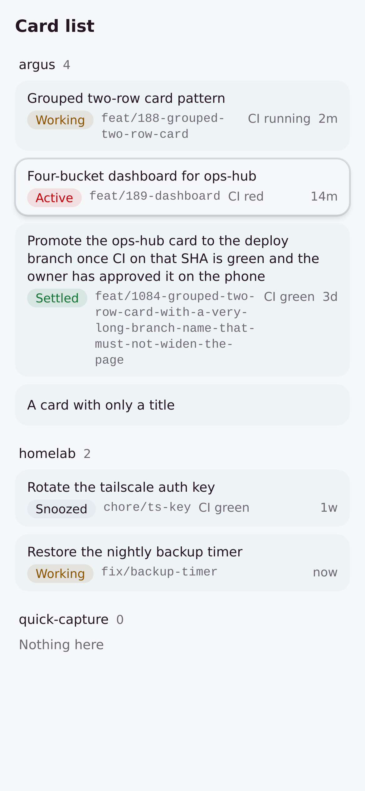
  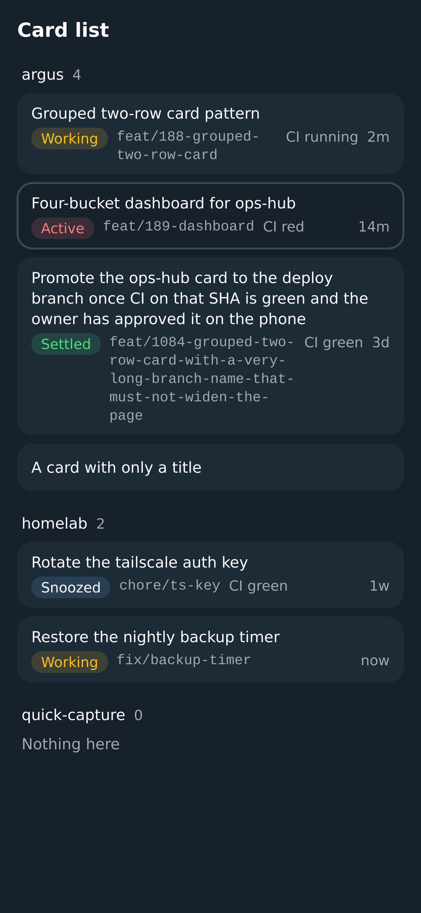 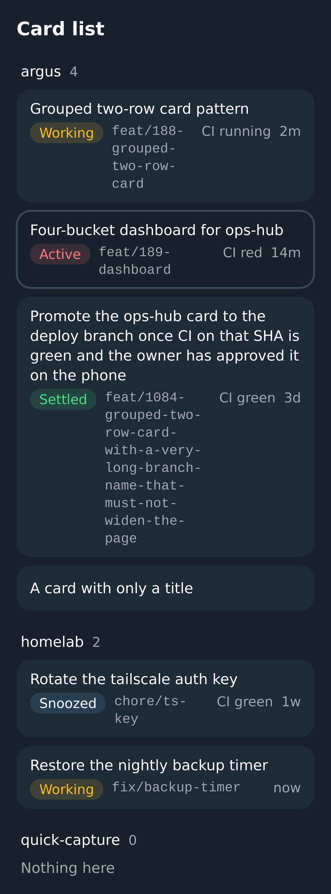

## Issue row

`issue-row` is the dense list row for issues and PRs from [design-system#192](https://github.com/deanjstone/design-system/issues/192):
one 44px row with the priority, id, status, title, labels, project or wave, due date and assignee. It follows
`components/common/issues/issue-line.tsx` in [circle](https://github.com/ln-dev7/circle) (MIT, Copyright (c) 2025 lndev-ui |
Circle Template; credited in the source header), rebuilt on Base UI and this registry's tokens with none of circle's
dependencies. It pulls in `context-menu` and `dropdown-menu`.
`npx shadcn add deanjstone/design-system/issue-row`.

```tsx
<IssueRowList aria-label="Open issues">
  <IssueRow
    title="Dense issue and PR list row"
    href="/issues/192"                      // or onOpen={...}, or render={<Link to="..." />}
    priority={<SignalHighIcon aria-label="Priority: high" />}
    identifier="DS-192"
    status={<CircleDotIcon aria-label="Status: working" />}
    labels={<Badge variant="outline">design</Badge>}
    project="Wave 1"
    dueDate="Due Nov 12"
    assignee={<Avatar size="sm">...</Avatar>}
    actions={[
      { id: "assign", label: "Assign to me", onSelect: assign },
      { id: "close", label: "Close", onSelect: close, destructive: true },
    ]}
  />
</IssueRowList>
```

- **Columns drop away, the title never squeezes.** Below `sm` (640px) a row is the priority, the status, the title and
  the more button. At `sm` the id, due date and assignee join; at `lg` (1024px) the labels and the project or wave.
  The title takes what is left and wraps in full, so the row grows past 44px ([wrap by default](#wrap-by-default)); every other column keeps
  its width. Leave out a column and no empty slot is rendered, so give the rows of one list the same columns if you
  want their titles to line up.
- **Tap anywhere opens the item.** The title is the link (`href`), a button (`onOpen`) or your router's `Link`
  (`render`), and its hit area is stretched over the whole row. Anything of yours inside a column that must take its own
  tap (a button in `labels`, say) needs `relative z-10`; the more button already has it.
- **The actions behind circle's right-click have three touch-friendly doors.** `actions` opens from the trailing 44px
  more button (named "More actions for <title>", or `moreLabel`), from a right-click, and from a long-press of half a
  second (Base UI's context-menu trigger; a scroll or a lifted finger cancels it). All three open the same list. Menu
  items grow to 44px under a coarse pointer. A row with no `actions` has no more button and no menu.
- **iOS.** The row sets `-webkit-touch-callout: none` and `user-select: none` so the press reaches the menu, and its side
  padding has a floor over `env(safe-area-inset-left|right)`.
- **Accessible names are yours to give.** Priority, status and assignee are usually icons or avatars: pass an
  `aria-label` or `sr-only` text with each. The row itself is a list item named by its title.
- **Proof.** `node docs/issue-row/screenshots.mjs` builds the demo and opens it in one headless WebKit page at a time at
  390, 320, 768 and 1280px, light and dark. It checks no sideways scroll, rows of at least 44px, the column tiers, the title wrapping in full
  (at 320px it keeps at least 120px), the 44px more button, hit tests (a hit on the avatar lands on the title link: the
  check found the avatar swallowing the tap), tap, the menu actions, long-press and right-click, and writes
  `docs/assets/issue-row-<width>-<theme>.png` and `issue-row-<width>-menu-light.png`. The long-press is a dispatched
  `touchstart` held for 650ms, since Playwright has no touch-hold; it is not a physical finger. Screenshots:
  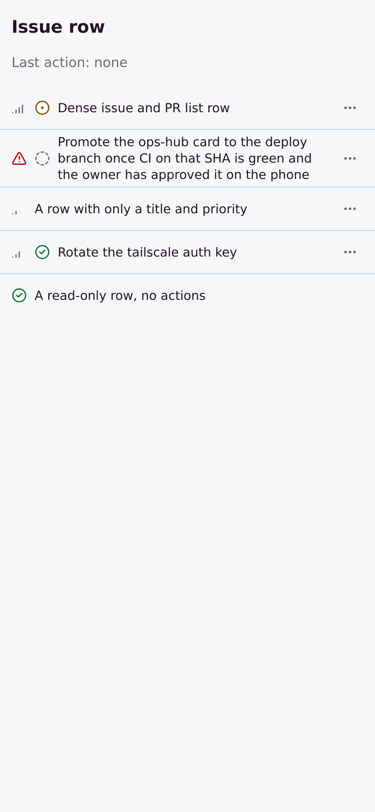 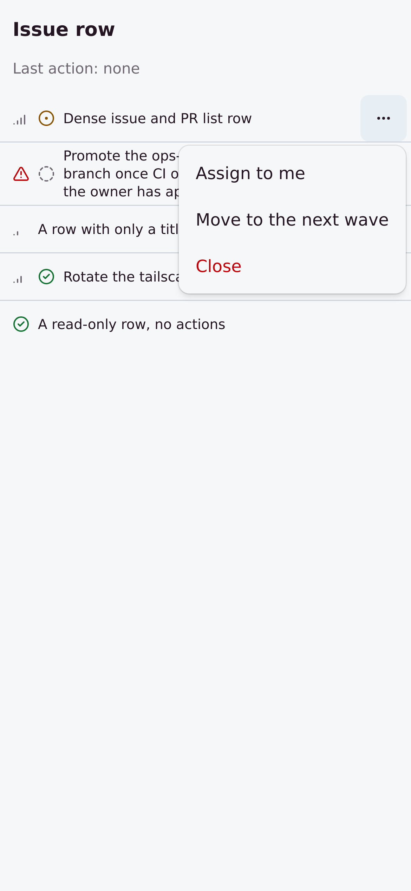
  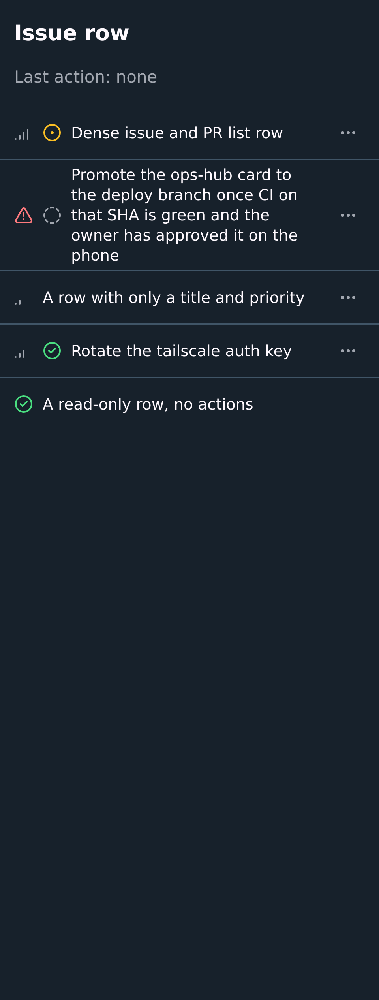 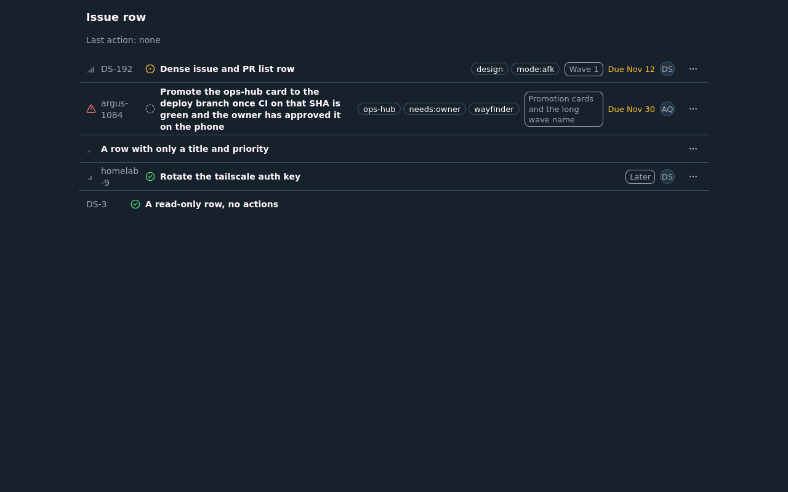

## Filter builder

`filter-builder` is the filter row editor with shareable URL state from [design-system#193](https://github.com/deanjstone/design-system/issues/193):
subject, operator and value rows ("label is", "label is not", "wave is any of", "mode has all of"), exclusion included, with
the whole list in one URL search param so a filtered view can be bookmarked and shared. It follows circle's
`components/data-table-filter/` and `store/filter-store.ts` ([circle](https://github.com/ln-dev7/circle), MIT, Copyright (c)
2025 lndev-ui | Circle Template; credited in each source header), rebuilt on Base UI and this registry's tokens with none of
circle's dependencies and no nuqs. Four items: `filter-core` (the model), `url-state` (the URL helper), `use-filter-state`
(the two joined as a hook) and the `filter-builder` block, which pulls in `badge`, `button`, `checkbox`, `input`,
`native-select`, `popover`, `sheet` and `use-mobile`.
`npx shadcn add deanjstone/design-system/filter-builder deanjstone/design-system/use-filter-state`.

```tsx
const FIELDS: FilterField<Issue>[] = [
  { id: "label", label: "Label", type: "option", options: [{ value: "bug", label: "Bug" }], accessor: (i) => i.label },
  { id: "wave", label: "Wave", type: "option", options: WAVES, accessor: (i) => i.wave },
  { id: "mode", label: "Mode", type: "multiOption", options: MODES, accessor: (i) => i.modes },
  { id: "title", label: "Title", type: "text", accessor: (i) => i.title },
  { id: "points", label: "Points", type: "number", accessor: (i) => i.points },
]

const [filters, setFilters] = useFilterState(FIELDS)          // ?filter=label:is-not:bug;wave:is-any-of:w1,w2
const shown = applyFilters(issues, filters, FIELDS)
<FilterBuilder fields={FIELDS} value={filters} onValueChange={setFilters} />
```

- **Types and operators.** `option` (is, is not, is any of, is none of), `multiOption` (has any of, has all of, has none of),
  `text` (contains, does not contain, case-insensitive) and `number` (equals, does not equal, greater than, less than).
  Filters are ANDed. A field appears in one row; "Add filter" starts the next unused field. Dates are not in this first cut.
- **One param, plain text.** `serializeFilters` writes `field:operator:value,value;...`, each piece percent-encoded, so `:`, `,`
  and `;` never appear inside a piece. `parseFilters(raw, fields)` checks every segment against `fields` and drops what it cannot
  trust (unknown field, an operator the type lacks, the wrong shape, a broken escape, a non-number in a number field), never
  throws, and reads at most 50 segments. A row with no value yet serialises as `label:is:` and filters nothing.
- **Your router, or none.** `useFilterState(fields, { param, history })` reads and writes the param through the History API
  (`replace` by default, so typing does not fill the back button; `push` adds an entry per change), follows back and forward,
  and keeps other params and the hash. With a router that owns the search params, call `parseFilters` and `serializeFilters`
  yourself and pass `value` and `onValueChange`. Filtering on the server: leave `accessor` out and use the builder to edit the list.
- **Phone: rows in a bottom sheet.** `layout="auto"` (default) uses `useIsMobile()`: below 768px, and a short coarse-pointer
  landscape phone, a Filters button with the count opens the rows in a bottom `sheet` (safe areas from the sheet), and the
  complete filters show as removable chips under the button. Closing the sheet drops rows still empty. `layout="inline"` or
  `"sheet"` forces one.
- **Touch.** Field, operator and a single value are native selects, so a phone shows its own picker; several values are a
  checklist of full-row labels (inline, behind a popover button; in the sheet, listed in place, so no popup opens over a
  sheet). Under a coarse pointer selects and inputs are 44px tall with 16px text (iOS does not zoom into them), the remove
  button, chips and checklist rows are 44px. Nothing depends on hover or right-click.
- **Words are yours.** `labels` takes every visible and spoken string. Each row is a `group` named by its sentence ("Wave is any of
  Wave 1, Later"); remove buttons say "Remove filter: <sentence>".
- **Proof.** `node docs/filter-builder/screenshots.mjs` builds the demo and opens it in one headless WebKit page at a time at
  390, 320, 768 and 1280px, light and dark. It checks no sideways scroll, the seeded URL, the sheet (flush with the bottom, full
  width), a tap on a checklist row, the count and URL following, a chip removing its filter, and that a reload and a second page
  opened on the copied URL show the same filters. WebKit headless does not report `pointer: coarse`, so the 44px and 16px checks
  run in a Chromium page with touch emulation at 390px. Writes `docs/assets/filter-builder-<width>-<theme>.png`,
  `-sheet-light.png` and `-checklist-light.png`. Screenshots: 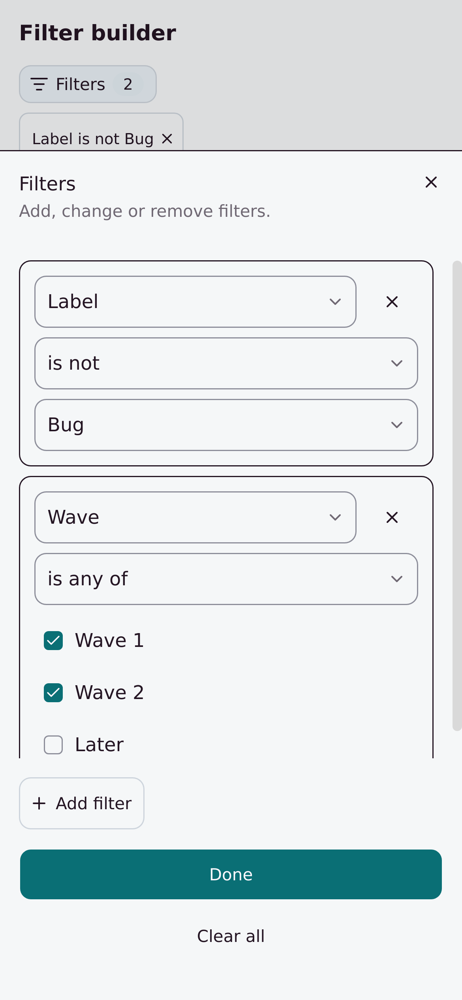
  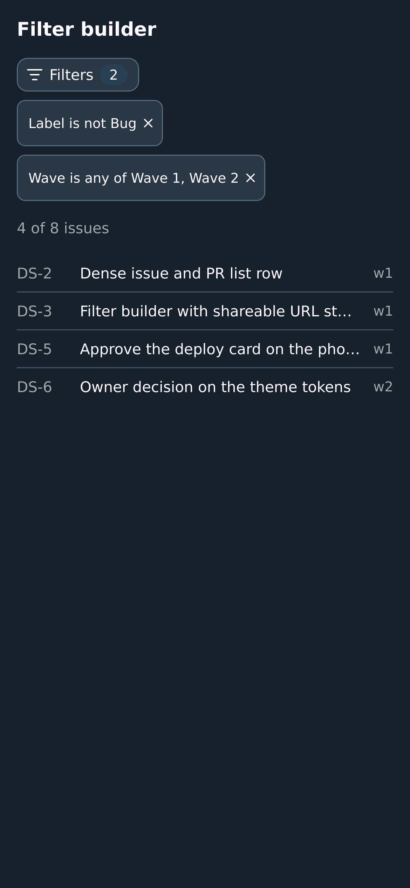 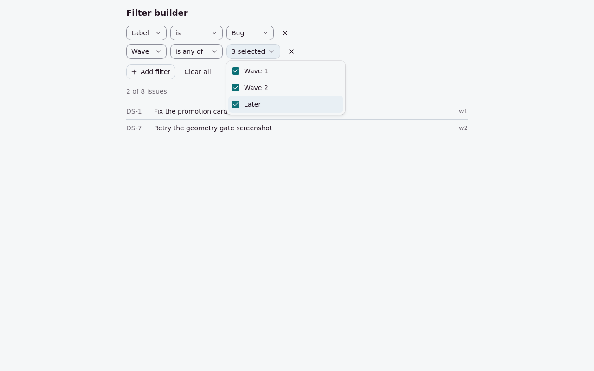

## Grouped list

`grouped-list` is the collapsible grouped list with a display menu from [design-system#194](https://github.com/deanjstone/design-system/issues/194):
items under group headers that show a count and collapse, and a Display button that picks what to group by (status, wave,
repo, label, whatever the view offers) and which row properties show. The choices are kept per view in localStorage. It follows
circle's `group-issues.tsx`, `grouped-issues-view.tsx` and `store/display-settings-store.ts` ([circle](https://github.com/ln-dev7/circle),
MIT, Copyright (c) 2025 lndev-ui | Circle Template; credited in each source header), rebuilt on Base UI and this registry's tokens
with none of circle's dependencies (no zustand, motion or react-dnd). Three items: `list-group-core` (the model), `use-display-settings`
(the persisted settings as a hook) and the `grouped-list` block (`GroupedList` and `DisplayMenu`), which pulls in `button`, `checkbox`,
`collapsible`, `native-select` and `popover`. It takes any row, so `issue-row` is one choice and not a dependency.
`npx shadcn add deanjstone/design-system/grouped-list deanjstone/design-system/use-display-settings`.

```tsx
const GROUPINGS: ListGrouping<Issue>[] = [
  { id: "status", label: "Status", keys: (i) => i.status, groupLabel: (k) => STATUS_NAMES[k], order: ["working", "todo", "done"] },
  { id: "label", label: "Label", keys: (i) => i.labels },            // a list: an issue with two labels is in both groups
]
const CONFIG: DisplayConfig = {
  groupings: ["status", "label"],
  properties: [{ id: "labels", label: "Labels" }, { id: "assignee", label: "Assignee", defaultVisible: false }],
  defaultGroupBy: "status",
}

const display = useDisplaySettings("pr-queue", CONFIG)       // localStorage key display-settings:pr-queue
const grouping = GROUPINGS.find((g) => g.id === display.settings.groupBy) ?? null
<DisplayMenu groupings={GROUPINGS} properties={CONFIG.properties} settings={display.settings}
  onGroupByChange={display.setGroupBy} onPropertyChange={display.setPropertyVisible} onReset={display.reset} />
<GroupedList groups={groupItems(issues, grouping)} collapsed={grouping ? (display.settings.collapsed[grouping.id] ?? []) : []}
  onToggleGroup={display.toggleCollapsed} getItemKey={(i) => i.id}
  renderItem={(i) => <IssueRow title={i.title} {...pickVisible({ labels: i.labels, assignee: i.assignee }, display.settings)} />} />
```

- **Grouping.** `groupItems(items, grouping, { noneLabel })` keeps each group's items in their given order. `order` lists the keys that
  go first; others follow as first seen. A key can be a list, so an item with two labels is drawn in both groups and counted in both
  (the headers' counts can then add up to more than the items). An item with no key goes in a last "none" group; a group nobody is in
  is not returned. `groupItems(items, null)` is one group of everything, drawn as a plain list with no header, so grouping off needs no
  second code path.
- **Collapse.** A header is a full-width 44px button inside a heading (`headingLevel`, default 3) with `aria-expanded`; the count stays
  on a collapsed header. `GroupedList` holds no state: pass `collapsed` and `onToggleGroup`. Collapsed groups are kept per grouping,
  so switching grouping does not carry them over.
- **Display settings.** `useDisplaySettings(viewId, config)` returns `settings`, `setGroupBy`, `setPropertyVisible`, `toggleCollapsed`,
  `reset` and `persisted`. Every list on the same view id, and its other tabs, stay in step. Storage access is wrapped in try/catch: where
  it throws (a private window, blocked site data) the settings still work for the page and `persisted` turns false. Stored text is parsed
  defensively and never throws: a bad field falls back to its default, a grouping, property or group the config no longer has is dropped,
  and a property added since takes its default. The server render uses the defaults and the client reads storage on hydration.
- **Properties.** `pickVisible({ priority, labels, ... }, settings)` returns the cells whose property is on; spread it into `IssueRow`.
  A cell the settings do not list is dropped. `IssueRow` still hides columns by screen width (`sm`, `lg`); a property switched on shows at
  the widths its column does.
- **Touch.** The Display button, a header and a property row are 44px tall under a coarse pointer; the Group by control is a native select
  (the phone's own picker) with 16px text so iOS does not zoom. The menu is a popover held inside the screen (`max-w-[calc(100vw-1rem)]`).
  Headers keep clear of the left and right safe areas. Nothing depends on hover or right-click.
- **Words are yours.** `labels` on `DisplayMenu` takes every visible and spoken string (`display`, `groupBy`, `noGrouping`, `properties`,
  `reset`); group names come from `groupLabel` and `noneLabel`.
- **Proof.** `node docs/grouped-list/screenshots.mjs` builds the demo and opens it in one headless WebKit page at a time at 390, 320, 768
  and 1280px, light and dark. It checks no sideways scroll, 44px headers and rows, a tap collapsing a group and a reload keeping it, the
  menu opening inside the screen, Repo and Label regrouping, collapsed groups kept per grouping, No grouping, Labels off surviving a reload
  and Reset. WebKit headless does not report `pointer: coarse`, so the 44px and 16px checks on the menu run in a Chromium page with touch
  emulation at 390px. Writes `docs/assets/grouped-list-<width>-<theme>.png` and `-menu-light.png`. Screenshots:
  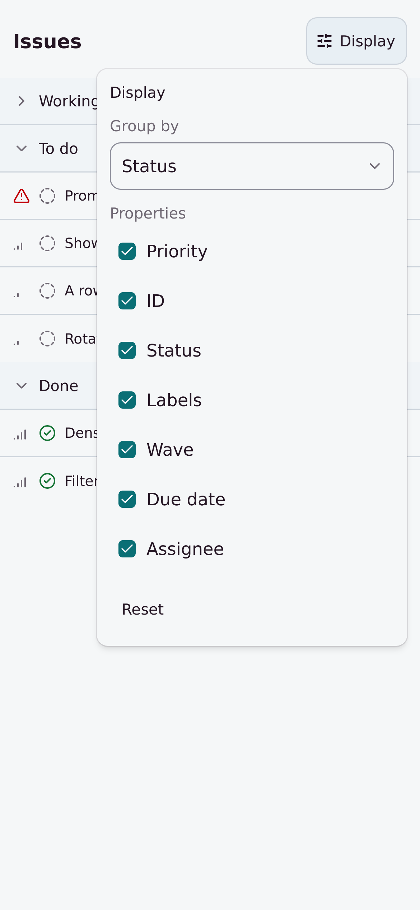 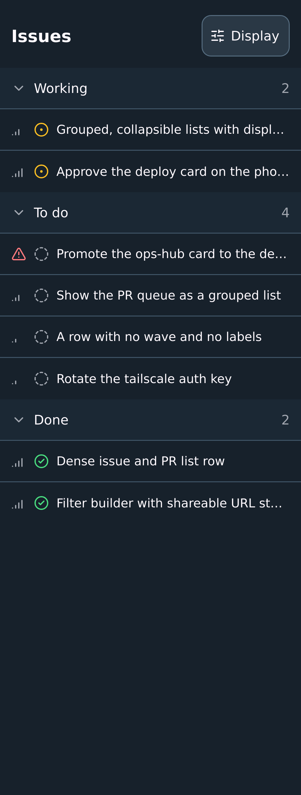
  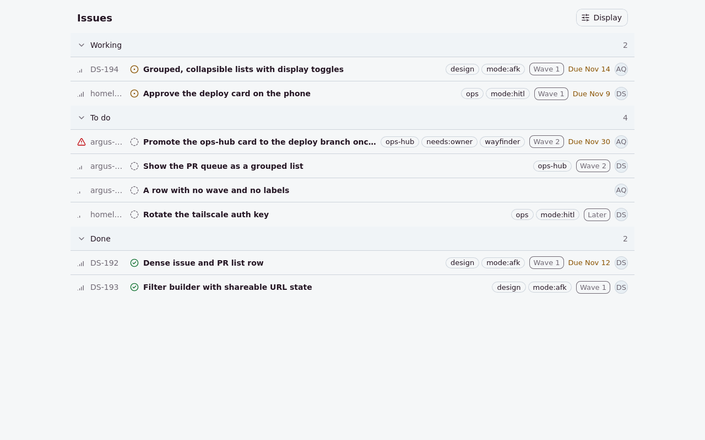

## File diff

`file-diff` is one changed file with its diff, moved from ops-hub's `file-diff.tsx`
([design-system#205](https://github.com/deanjstone/design-system/issues/205)). It pulls in `button`, `collapsible` and the
`diff-core` lib (the unified-diff parser, `parsePatch`). `npx shadcn add deanjstone/design-system/file-diff`.

```tsx
// `file` is GitHub's "list pull request files" shape; ops-hub's PullFile fits as it is.
<Card>
  <CardHeader><CardTitle>Files changed</CardTitle></CardHeader>
  <CardContent className="flex flex-col gap-2">
    {files.map((file) => (
      <FileDiff key={file.filename} file={file} bleed className="max-md:-mx-4" />
    ))}
  </CardContent>
</Card>
```

- **Everything wraps.** The file path, the hunk headers and every code line wrap (`whitespace-pre-wrap` keeps the
  indentation, `wrap-anywhere` breaks a token with no spaces). There is no sideways scroll at any width.
- **The sign has its own column.** The `+` or `−` sits in a narrow column apart from the code, so a wrapped line stays
  indented under its code.
- **One line-number column on phones.** From `md` up there are two (old, new). Below `md` there is one: the new line
  number, or the old one on a deleted line, which has no new one.
- **Edge to edge on phones.** `bleed` drops the block's side borders and rounded corners below `md` and keeps its body
  clear of the safe areas (`max-md:pl-safe max-md:pr-safe`). The block cannot know the padding of the card around it, so
  pair `bleed` with a negative margin that matches: `className="max-md:-mx-4"` inside a `p-4` card.
- **Collapsed past 400 lines**, or when the file has no patch (binary, too large, or a pure rename), which says why once
  opened. `defaultOpen` overrides it either way. Other props of `Collapsible` pass through.
- **Data attributes.** `data-slot="file-diff"` and `data-file` on the root; each line is `data-slot="file-diff-line"` with
  `data-line` of `hunk`, `add`, `del`, `context` or `note`.
- **Proof.** `node docs/file-diff/screenshots.mjs` builds the demo and opens it in one headless WebKit page at a time at
  390 (light and dark), 320 and 1280px. It checks no sideways scroll, nothing in a diff clipped or outside the viewport,
  the long code line and the long path wrapping in full, one line-number column below `md` and two above, and the diff
  running edge to edge in its card on phones. Writes `docs/assets/file-diff-<width>-<theme>.png`. Screenshots:
  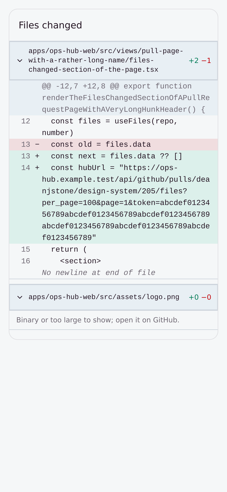 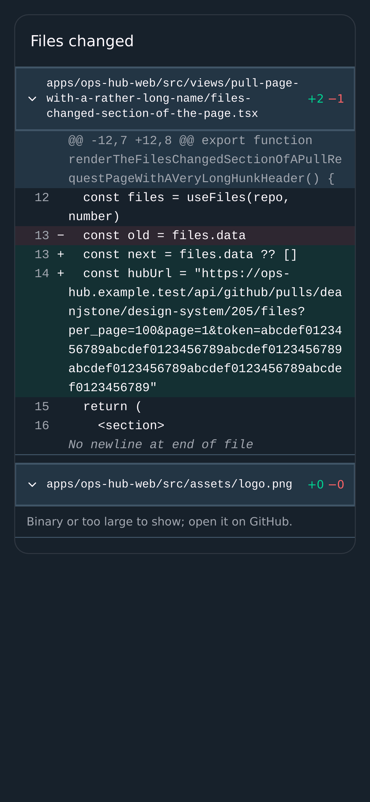
  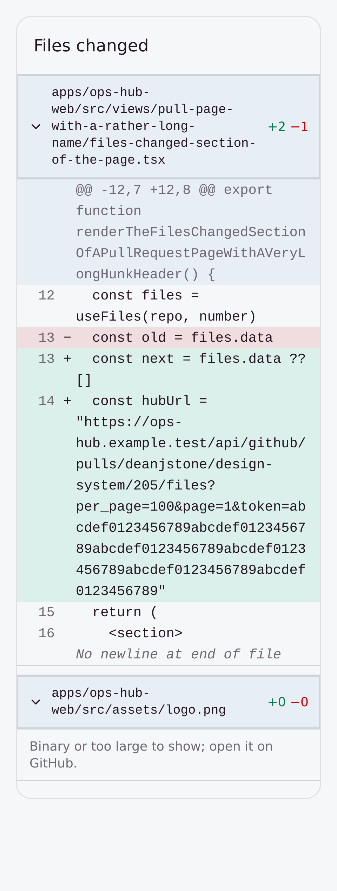

## Style

- `base-nova` shadcn style, OKLCH color tokens, Tailwind v4 (`@theme inline`,
  no `tailwind.config.js`).
- Base UI (`@base-ui/react`) primitives under the hood; components are copied,
  not installed as a dependency — once pulled into a consumer, edit them there.
  Composition uses Base UI's `render` prop, not Radix's `asChild`.
  Switched from `new-york`/Radix in [ADR-0001](docs/adr/0001-switch-component-library-to-base-ui.md).
- The `theme` item ships the full token set: core colors (background,
  foreground, primary/secondary/accent/muted, destructive, border/input/
  ring), plus `--radius`, `--card`, `--popover`, `--chart-1..5`, the status
  tokens `--success`/`--warning`/`--unreachable`/`--critical` (each with a
  `-foreground`; `badge` has a variant per role), and
  `--font-sans` (IBM Plex Sans — typeface is mechanics here, not identity;
  see [ADR-0002](docs/adr/0002-registry-owns-the-font-token.md)).
- Opt-in additions to the `theme` item (no effect unless a consumer uses
  the utilities): a 6-step `surface-0..5` dark-elevation ramp plus
  `surface-border`/`surface-border-light`, `pulse-slow`/`fade-in`/
  `slide-up` animations, `.card`/`.card-hover`/`.btn-primary`/`.btn-ghost`/
  `.badge`/`.input` plain-CSS component recipes, `.dark`-scoped
  selection/calendar-picker-icon styling for always-dark apps, a tokenized
  scrollbar thumb (both modes), `radius-2xl`/`radius-3xl`, `surface-glass`/
  `dialog-glass`/`dropdown-glass`/`surface-grain` opt-in chrome textures, and
  PWA/Electron app-shell mechanics (`pt-safe`/`pb-safe`/`pl-safe`/`pr-safe`,
  `--app-titlebar-*` topbar geometry, the `.wco` variant, `.drag-region`) —
  see [DESIGN.md](DESIGN.md#app-shell).
- **66 UI items**, three hooks and the `highlighter` lib, all `base-nova` style and Base UI-based, pulled the same
  way as `theme`/`button` above:
  - *Controls* — `button`, `input`, `textarea`, `select`, `native-select`,
    `combobox`, `checkbox`, `radio-group`, `switch`, `slider`, `input-otp`,
    `calendar`, `date-picker`, `label`, `kbd`
  - *Surfaces and overlays* — `card`, `dialog`, `alert-dialog`, `sheet`,
    `drawer`, `popover`, `hover-card`, `dropdown-menu`, `context-menu`,
    `collapsible`, `accordion`, `scroll-area`, `resizable`
  - *Display and feedback* — `badge`, `alert`, `avatar`, `progress`, `skeleton`,
    `separator`, `tabs`, `table`, `sonner`, `spinner`, `empty`, `tooltip`,
    `aspect-ratio`, `carousel`, `link-pill` (see [LinkPill](#linkpill)),
    `graph-3d` (a 3D force-graph orb; see [docs/graph-3d](docs/graph-3d/README.md))
  - *Conversation* — `message`, `bubble`, `message-scroller`, `marker`,
    `attachment`
  - *Agent turns* — `trace`, `code-block`, `questionnaire` (see
    [Agent-interface items](#agent-interface-items))
  - *Navigation and lists* — `sidebar` (with the `use-mobile` hook), `item`,
    `breadcrumb`, `command`, `menubar`, `navigation-menu`, `pagination`
  - *Forms and grouping* — `field`, `input-group`, `toggle`, `toggle-group`,
    `button-group`
  - *Data* — `chart` (recharts, loaded lazily) and `data-table`; see
    [Data primitives](#data-primitives)

  `tooltip` and `sidebar` need a `TooltipProvider` at the app root.
  `message-scroller` and `questionnaire` add the `@shadcn/react` package;
  `code-block` adds `shiki` (through `use-highlighted-code`); `command` adds `cmdk`;
  `calendar` adds `react-day-picker` and `date-fns`; `carousel` adds `embla-carousel-react`;
  `input-otp` adds `input-otp`; `resizable` adds `react-resizable-panels`;
  `graph-3d` adds `three` and `d3-force-3d` (through `graph-3d-engine`, loaded lazily).

  The set grows when a consuming app needs an item, not by shipping the whole
  shadcn catalogue. Adding another is mechanical, so ask rather than vendoring a
  copy locally. `registry.json` is the list of record; an item missing from it is not
  published.
