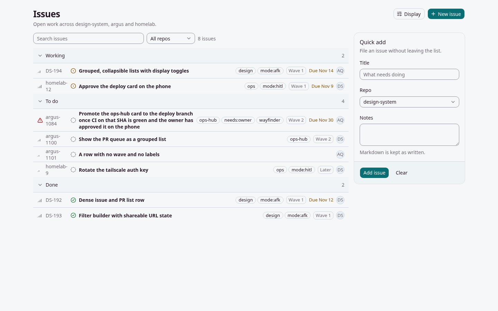
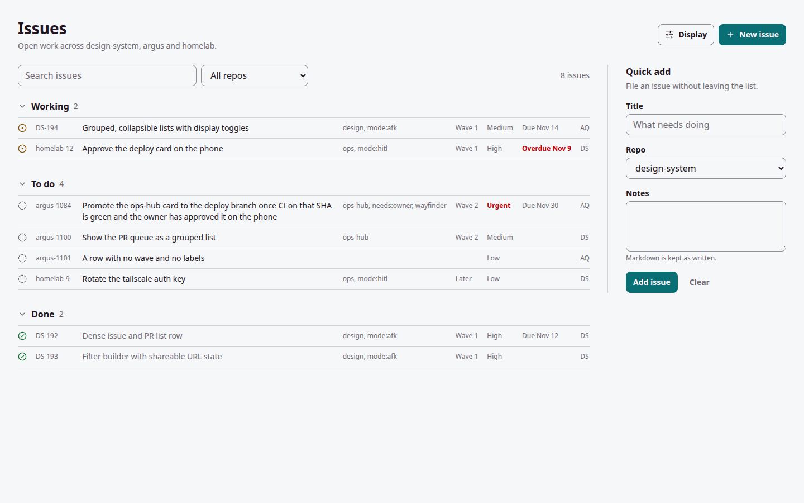
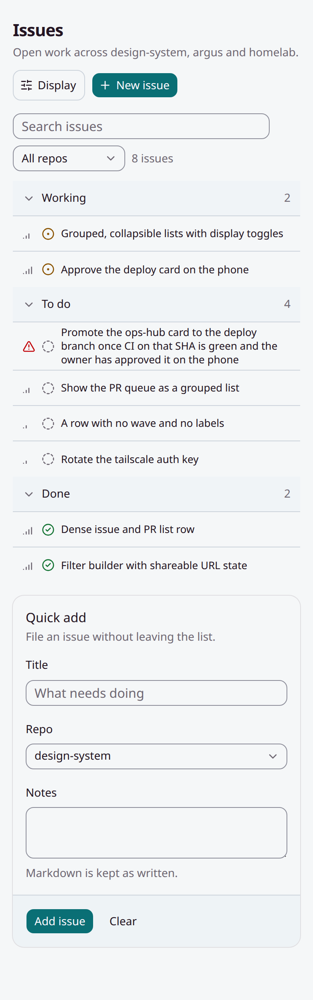
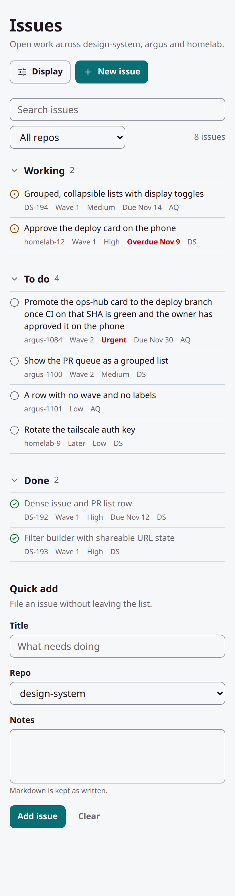

# Hierarchy and density audit, with a proposed scale

Date: 2026-11-12. Owner-requested. Scope: design-system at `e4ea12c` (`main`, v3.24.0).

**Nothing in the registry changes, and the colour tokens and gradients stay as they are** (owner decision,
2026-11-12). The proposal covers spacing, type and density only. This is a report and a sample. The sample lives in
`docs/audits/hierarchy-density/` and is scoped to its own `.hd` class: no component, token, theme or
`registry.json` entry is touched, so no consumer sees a difference.

## Method

- **Static census.** Every class string in `registry/base-nova/ui` and `registry/base-nova/blocks`, counted by
  size, weight, spacing, colour and radius.
- **Rendered census.** One screen (page header, toolbar, grouped issue list, a form) built twice from the same
  data: once with the registry components at their defaults (`current.tsx`), once on the proposed scale
  (`proposed.tsx`, `proposed.css`). `screenshots.mjs` reads the computed styles of both in Chromium at
  1440x900 (mouse) and 390x844 (touch).
- The current screen is composed the way `docs/grouped-list/demo.tsx` composes it. It adds the
  `border-border` base rule `shadcn init` gives a consumer. It overrides no component's size, weight, colour or
  spacing.

Run it: `node docs/audits/hierarchy-density/screenshots.mjs` (22 checks, all pass).

## The five biggest problems

### 1. Weight is inverted: items outrank their headings

| Level | Element | Size / weight | Source |
|---|---|---|---|
| Page | `PageHeader` h1 | 26 / 600 (21 on a phone) | `blocks/page-header.tsx:22` |
| Section | `CardTitle` | 16 / 500 | `ui/card.tsx:41` |
| Group | `GroupedList` heading | 14 / 500 | `blocks/grouped-list.tsx:63` |
| Item | `IssueRow` title | 14 / **600** | `blocks/issue-row.tsx:99` |

The heaviest text in the list is every row title. Eight bold rows sit under three medium-weight group headings,
so the eye lands on the items and the grouping reads as a tinted band, not a heading. On a phone the page title
is 21px over 13px and 14px text: one step above the body, not a title.

### 2. The type scale has steps too close to tell apart

- `theme/tokens.css:18-35` defines nine sizes: 11, 12, 13, 14, 16, 18, 21, 26, 30px. Four are within 3px.
- In use: 117 of 192 size classes are `text-sm`. Four more sizes are arbitrary values (`text-[0.8rem]` is
  12.8px, between two tokens).
- Three weights are in play (500 used 62 times, 400 eight, 600 seven), and 500 against 400 is the main
  hierarchy signal. That difference is hard to see at 14px.
- The sample screen draws 13, 14, 16 and 26px. The 13 and 14 do the same job.

### 3. Spacing has no rhythm

- 38 distinct padding, margin and gap values across the components. Half steps are common: `1.5` (85 uses),
  `2.5` (48), `0.5` (19). So 2, 4, 6, 8, 10 and 12px are all live, and neighbours differ by 2px.
- The sample screen draws 10 distinct values: 2, 4, 6, 8, 10, 12, 16, 20, 24, 32.
- Groups in a list are separated by a filled band and 0px of space. Space is not used to show structure.
- Four radii on one screen: 8, 10, 14 and 32px.

### 4. Density is set per component, and touch is patched on afterwards

- Controls are 32px (`h-8`, `ui/button.tsx:24`). List rows are 44px (`min-h-11`, `blocks/issue-row.tsx:109`).
  On a desktop the rows are touch-sized and the controls beside them are mouse-sized.
- Touch sizes come from an unlayered `@media (pointer: coarse)` block (`theme/tokens.css:995`) that sets
  `min-height: 44px` on a list of slots. Padding and type do not follow, and a slot not on the list stays 32px.
  The 2026-11-07 audit found the same thing.
- On a phone a row hides five of its eight fields: id, labels, wave, due date and assignee
  (`issue-row.tsx:126-151`). The row stays 44px tall.
- On a desktop the id column is a fixed 64px (`w-16`). `homelab-12` wraps to two lines, so the rows are 44px or
  66px. The right-hand cluster is flex, not columns, so labels, wave and due date start at a different x on
  every row and cannot be scanned down.

### 5. Many colours, little meaning

- The sample screen draws 15 colours. The components use 76 colour-and-alpha combinations and 15 alpha steps.
  `theme/tokens.css` declares 182 custom properties.
- Ocean's `--background`, `--card` and `--popover` are the same value (`#f5f7f8`). `--secondary`, `--muted` and
  `--accent` are three near-identical tints (`#e4ecf2`, `#e8eff4`, `#d8e4ee`).
- Every due date is amber (`text-warning`, `issue-row.tsx:151`), including one on a finished issue. The colour
  says "warning" and means "this row has a date".
- One row holds four chip treatments: an outlined pill (label), a bordered box (wave), coloured text (due) and
  a filled circle (assignee).

The tokens are not the fault here, and they stay. The fix is in how the components spend them: see the rules
under the proposed scale.

## The proposed scale

All of it is in the token block at the top of `docs/audits/hierarchy-density/proposed.css`.

### Colour: the theme's tokens, unchanged

No colour token is added, removed or revalued, and no gradient is touched. The sample reads twelve existing
tokens and declares none of its own, so it follows every theme and its dark mode:

`--background`, `--foreground`, `--muted-foreground`, `--border`, `--input`, `--primary`,
`--primary-foreground`, `--primary-text`, `--ring`, `--warning`, `--success`, `--critical`.

Three rules for spending them, none of which needs a token change:

1. **A signal colour means the signal.** `--warning` is in-progress. `--critical` is overdue or urgent. A due
   date that is not overdue is `--muted-foreground`.
2. **One treatment for metadata.** Labels, wave, priority, due date and assignee are plain 12px text, not four
   kinds of chip.
3. **No new alpha steps.** A tint is a token, not `muted/40` beside `muted/50`.

### Space: 7 steps

4, 8, 12, 16, 24, 32, 48px (`s1` to `s7`). No half steps. Radius is one value, 8px.

### Type: 5 sizes, 2 weights

| Token | Size / line | Job |
|---|---|---|
| `t1` | 12 / 16 | row metadata, hints |
| `t2` | 14 / 20 | body, row titles, buttons |
| `t3` | 16 / 24 | group and section headings, text in a field |
| `t4` | 20 / 28 | dialog and sheet titles (not drawn on the sample screen) |
| `t5` | 28 / 36 | the page title |

Weights: 400 and 600. 600 is for headings, labels, buttons and the one field in a row that needs action.

### Density: one token

`--hd-pad` is the block padding of every control and row: 8px, or 12px under `pointer: coarse`. It follows the
pointer, not the width, which is the rule DESIGN.md already sets.

## Current and proposed

| | Current | Proposed |
|---|---|---|
| 1440 |  |  |
| 390 |  |  |

Dark: `docs/assets/hierarchy-density-{current,proposed}-{1440,390}-dark.png`.
A second theme, Grove: `docs/assets/hierarchy-density-{current,proposed}-1440-grove.png`.

Measured in Chromium, light theme:

| Distinct values drawn | Current 1440 | Proposed 1440 | Current 390 | Proposed 390 |
|---|---|---|---|---|
| Font sizes | 4 (13, 14, 16, 26) | 4 (12, 14, 16, 28) | 4 (13, 14, 16, 21) | 4 (12, 14, 16, 28) |
| Weights | 3 | 2 | 3 | 2 |
| Colours | 15 | 11 | 14 | 11 |
| Spacing values | 10 | 6 | 9 | 6 |
| Radii | 4 | 1 | 2 | 1 |
| Control height | 32 | 38 | 44 | 46 |
| Row height | 44 or 66 | 37 or 57 | 44 or 60 | 57 or 97 |
| Fields shown per row | 8 | 8 | 3 | 7 |
| Page height | 900 | 900 | 1244 | 1481 |

What changed, by problem:

1. **Hierarchy.** Three levels that differ by size: 28 (page), 16/600 (group, section), 14/400 (item). Row titles
   are regular weight. Finished rows drop to `--muted-foreground`.
2. **Type.** Metadata is one 12px style. The 13px step is gone.
3. **Spacing.** 24px of space separates groups in place of a filled band. The form has no card around it: a
   single divider and space.
4. **Density.** On a desktop the list is one grid, so id, labels, wave, priority, due and assignee are aligned
   columns and no id wraps. Rows are 37px (16% shorter). On a phone a row is two lines, 57px, and shows seven
   fields in place of three.
5. **Colour.** Same tokens, spent on meaning. Status keeps its amber and green icons. A due date is grey until
   it is overdue, then it is `--critical`, bold, and says "Overdue". Priority is a word, `--critical` and bold
   only when urgent. The filled bands, tints and alpha steps are not used, which is where 15 colours become 11.

## Costs and limits of the proposal

- **The phone page is 19% longer** (1481px against 1244px). That buys four more fields on every row. Labels are
  still hidden on a phone.
- **Controls get bigger on a desktop**: 38px against 32px.
- **Colour problems that live in the tokens stay.** The three near-identical tints and the shared
  background, card and popover value are untouched. The sample avoids them; the registry still has them.
- **No filled surfaces in the sample** means cards, popovers and sheets are untested. The sample has no overlay.
- **The sample is one screen.** Charts, the 3D graph, the app shell's glass and the six T3 themes are outside it.
- **Native selects** are used in the sample. They are not restyled.

## If this is adopted

None of this is done. Each is additive, and would be its own issue:

1. Ship the spacing and type scale as an opt-in item, the way `theme-ds` ships. No default changes, and no
   theme or colour token changes.
2. Add a `density` token that the coarse-pointer block sets, and have control and row padding read it. This
   retires the per-slot `min-height` list without changing a size on the day it lands.
3. `IssueRow`: opt-in props for a two-line phone row and a grid-column desktop row. Defaults stay as they are.
4. A lint rule in `design-check` for half-step spacing, arbitrary `text-[…]` sizes and new alpha steps in new
   code, warn-only.

## Files

- `docs/audits/hierarchy-density/proposed.css`: the tokens and the rebuilt screen's styles.
- `docs/audits/hierarchy-density/proposed.tsx`, `current.tsx`, `data.ts`: the two versions and their shared data.
- `docs/audits/hierarchy-density/screenshots.mjs`: the build, the checks, the census and the screenshots.
- `docs/assets/hierarchy-density-*.png`: ten screenshots.
