# Primitives usage audit, with an iPhone reading scorecard

Date: 2026-11-12 (Part A collected 18:05 AEDT, renders 16:25 to 17:55 AEDT). Owner-requested. Scope: every frontend the owner runs, measured against design-system `v3.24.0` (`9701235`).

**Nothing in the registry changes in this audit.** It measures how the registry's UI primitives and tokens are used, renders the apps on an iPhone and a desktop, scores each screen, and recommends changes. Every recommendation is additive and opt-in; colour tokens and gradients stay as they are (owner decision on [design-system/207](https://github.com/deanjstone/design-system/issues/207)). It builds on the [mobile-first PWA audit](2026-11-07-mobile-first-pwa.md) and the [hierarchy and density audit](2026-11-12-hierarchy-density.md) and does not repeat them.

The reader this is for has ADHD and reads on an iPhone first. A screen has to give four things: a hierarchy the eye can scan, little clutter, an obvious next action within thumb reach, and state that shows at a glance.

## Method

**Part A, usage (scripted).** `primitives-usage/collect.mjs` reads each app at its repo's `origin/main` with `git ls-tree` and `git cat-file`; it checks nothing out. It compares every registry file in an app with the registry at all 64 release tags, undoing what the shadcn CLI rewrites on install, follows the import graph, and counts classes, colours and sizes in the app's own files. Output: [`output/report.md`](primitives-usage/output/report.md) and `output/data.json`.

**Part B, rendering (scripted).** Each app was built from a throwaway worktree of `origin/main` and served on localhost. `render.mjs` opens one headless WebKit page at a time: iPhone 390x844 (touch, DPR 3) and desktop 1440x900, light and dark, plus 320px wide and reduced motion. Every request off localhost is answered from a fixture in `screens/<app>/mocks.json` or aborted, so no run touched a live system. `scorecard.mjs` measures each screen in the page (`page.evaluate`), not by eye. Output: [`output/scorecard.md`](primitives-usage/output/scorecard.md) and 144 screenshots under `primitives-usage/screens/`.

Run it: [`primitives-usage/README.md`](primitives-usage/README.md).

**What was kept from the first, stopped run:** `apps.json`, `collect.mjs`, `measure.mjs`, `report.mjs` and the test, with three fixes (a tokeniser that survives apostrophes in JSX, registry-installed CSS no longer counted as app code, radius steps resolved from the app's own `--radius`). Their output was regenerated.

**Limits.**

- 13 apps were rendered (26 screens). `budget/web` and `slate-reader` were not ([design-system/215](https://github.com/deanjstone/design-system/issues/215)); `argus/apps/email` is the same app as `email/apps/email` and was not rendered twice. Their Part A data is complete.
- Screens are drawn from fixtures, not the owner's data. Row counts and title lengths are plausible, not real.
- Headless WebKit is not an iPhone. It reports zero for `env(safe-area-inset-*)` and cannot show an installed PWA; the harness simulates the insets by setting the registry's `--safe-*` tokens (`*-iphone-insets-light.png`). The device findings stay with the owner's retests, [design-system/166](https://github.com/deanjstone/design-system/issues/166) and [design-system/168](https://github.com/deanjstone/design-system/issues/168).
- Part A counts what the source declares, not what a browser drew. Part B measures what was drawn, on the chosen screens only.
- The renders ran under a memory gate after the host's out-of-memory kill at 14:38 AEDT: one build, one browser page, at a time.

## Summary: five findings, ranked by what they cost a reader on an iPhone

### 1. Body text is under 16px on 23 of 26 screens, and 22 screens draw more than three sizes

The registry's body size is 14px (`text-sm`) and its small size 13px (`text-xs`); apps add arbitrary sizes on top (email: `text-[13px]` x22, `text-[11px]` x9, `text-[13.5px]` x7; budget: `text-[10px]` x192). On an iPhone the email inbox draws seven sizes between 11 and 16px and its rows are set in 12.5px. Only reader's article view, sparky's bills and briefings pass.

This cuts across design-system#207: its scale sets body at 14px, and the owner's reading rule is 16px on an iPhone. See "Data for #207".

### 2. Accepted fixes are not reaching the apps: 56 of 200 primitive copies are stale, all behind their own pin

Moving the `@design-system` alias does not move the copied code. Ten apps pinned at v3.18.0 or v3.22.0 still carry `card`, `badge`, `input` and `textarea` from v3.6 to v3.9, so they lack the wrap fixes and the 16px input. Six myargus apps carry `card-list` from v3.23.0, so the owner's "wrap everywhere" decision ([design-system/205](https://github.com/deanjstone/design-system/issues/205), in v3.24.0) has not reached them: 12 screens cut text short with an ellipsis, and a stockade row shows 9% of its detail line. Local edits are rare (6 files); drift is almost all staleness.

### 3. Seven screens have no page title on an iPhone

ops-hub (all three screens), email's inbox, jobs, watchtower and knowledge's chat show the app name in the floating bar and no `h1`. `PageHeader hideOnPhone` removes it. On 12 screens no single element is clearly the largest.

### 4. State is drawn off the tokens and fails contrast

watchtower draws Healthy and Degraded from chart colours: "Healthy" is 2.86:1 on its tint. shell's plan page tints finished steps emerald: 25 contrast failures on one iPhone screen. atto1 marks state with colour alone. The registry's own destructive text on its wash is 4.25 to 4.4:1 in dark mode. 12 screens fail contrast in at least one of the four renders.

### 5. 31 of 66 UI primitives are in no app, while apps hand-build what three of them do

`alert`, `native-select` and the `issue-row`, `grouped-list` and `filter-builder` blocks are installed nowhere; five apps hand-build notices, five use a raw `<select>`, and every list is `card-list`. So design-system#207's `IssueRow` props would reach no screen as written.

Smaller findings: tap targets under 44px on 11 screens (toggle-group items are 28px on a phone, a gap in the registry's floor); the primary action is out of thumb reach on 4 of the 5 screens that have one; atto1's dashboard scrolls 295px sideways at 390px; email sends every correspondent's address to `unavatar.io`.

## Apps verified

The README's Consumers table was a claim. Checked on each repo's `origin/main`; the README is corrected in this change.

| Repo | App path | Pin | Rendered | Difference from the README (read 2026-11-07) |
|---|---|---|---|---|
| argus | `apps/email` | v3.18.0 | no (same app as `email`) | Still in argus, and also split out as `deanjstone/email` (`b1f0f97`, 9 Nov). Two copies, same usage numbers |
| argus | `apps/watchtower` | v3.18.0 | yes | none |
| ops-hub | `apps/ops-hub-web` | v3.22.0 | yes | Moved out of argus (`3394544`, 10 Nov); pin moved from v3.18.0 |
| email | `apps/email` | v3.18.0 | yes | New row |
| myargus | `apps/briefings`, `jobs`, `knowledge`, `reader`, `shell`, `stockade` | v3.22.0 | yes, all six | `apps/jobs` was missing; pins moved from v3.18.0 |
| homelab | `services/scan-app/web` | v3.1.0 | yes | none |
| quick-capture | `web` | v3.1.0 | yes | none |
| atto1 | repo root | v3.1.0 | yes | none |
| budget | `web` | none | no | none: forked `components/ui`, no `components.json` |
| sparky | repo root | none | yes | New row: no registry components, but its `src/design-system/tokens.css` is `theme/tokens.css` at v3.24.0, byte for byte |
| slate-reader | `apps/server`, `apps/client` | none | no | `apps/server` has a `components.json` (style `new-york`, no registry alias). `link-pill-core` is identical to v3.24.0, not v2.7.0; `link-pill-html` has one local line. The repo is archived on GitHub |

How the list was built: every repo under `~/repos` and every unarchived `deanjstone` repo on GitHub was searched for `components.json`, a Vite config, an `index.html` and `.tsx` files. No frontend turned up beyond these. `scriptable-private` holds iOS Scriptable HTML widgets, which are not apps.

## Usage matrix

Cell: the number of the app's own files that import the primitive; `d` = imported only by another registry copy; `0` = present, imported by nothing. Mark: none = identical to v3.24.0, `~` = stale (matches an older tag), `*` = local edit, `F` = forked. Blank = not in the app. Columns: a-em argus/email, wt watchtower, em email, ops ops-hub-web, brf briefings, job jobs, kno knowledge, rdr reader, shl shell, stk stockade, scan scan-app, qc quick-capture, atto atto1, bud budget, spk sparky, sl-s and sl-c slate-reader server and client.

| Primitive | a-em | wt | em | ops | brf | job | kno | rdr | shl | stk | scan | qc | atto | bud | spk | sl-s | sl-c |
|---|---|---|---|---|---|---|---|---|---|---|---|---|---|---|---|---|---|
| `button` | 11 | 1 | 11 | 19 | 1 | 4 | 6 | 8 | 12 | 11 | 1~ | 1~ | 5~ | 80* |  |  |  |
| `card` | 1~ | 2~ | 1~ | 8~ | 1~ | 1~ | 2~ | d~ | 9~ | d~ | 1~ | 1~ | 6~ | 38~ |  |  |  |
| `label` | 1 | d | 1 | d |  | d | d | d | 5 | 5 | 1 | 1 | 1 | 27~ |  |  |  |
| `input` | 5~ | d~ | 5~ | 4~ |  | d~ | 6~ | 3~ | 7~ | 5~ |  | 1~ | 1~ | 30* |  |  |  |
| `dialog` | 2 |  | 2 | d |  |  |  | 1 |  |  |  |  | 0~ | 11* |  |  |  |
| `tabs` | 1 |  | 1 |  |  |  |  |  | 1 |  |  |  | 0~ | 5* |  |  |  |
| `table` |  |  |  | 1 |  | 1 |  |  | 1 |  |  |  |  |  |  |  |  |
| `badge` | 3~ | 2~ | 3~ | 19~ | 0~ | 1~ | 3~ | 0~ | 5~ | 5~ | 1~ |  | 2~ | 19~ |  |  |  |
| `alert-dialog` |  |  |  | 1 |  |  |  |  | 1 |  | 1~ |  |  | 6F |  |  |  |
| `avatar` |  |  |  |  |  |  |  |  |  |  |  |  |  | 4F |  |  |  |
| `checkbox` | 2 |  | 2 |  |  |  | 1 |  | 2 | 1 |  |  |  | 3F |  |  |  |
| `collapsible` |  | 1 |  | 4 |  |  |  |  |  |  |  |  |  | 2F |  |  |  |
| `drawer` |  |  |  | 1 |  |  |  |  |  |  |  |  |  | 2F |  |  |  |
| `dropdown-menu` |  |  |  |  |  |  |  |  |  |  |  |  |  | 5F |  |  |  |
| `popover` | d | d | d | d | d | d | d | d | d | d | d |  |  | 4F |  |  |  |
| `progress` |  |  |  |  |  |  |  |  |  |  |  |  | 1 | 10F |  |  |  |
| `scroll-area` |  |  |  |  |  |  |  |  |  |  |  |  |  | 3F |  |  |  |
| `select` | 3 |  | 3 | 3 |  |  |  |  |  |  |  | 1 |  | 13F |  |  |  |
| `separator` |  | 1 |  | 1 |  | d | d | d | 1 | d |  |  |  | 1F |  |  |  |
| `sheet` | d | d | d | d | d | d | d | d | d | d | d~ |  |  | 4F |  |  |  |
| `skeleton` |  |  |  | 22 | 1 | 1 | 4 | 1 | 3 |  |  |  | 1~ | 3* |  |  |  |
| `slider` |  |  |  |  |  |  |  |  |  |  |  |  |  | 2F |  |  |  |
| `sonner` |  |  |  | 1 |  |  |  |  |  |  |  |  |  | 2F |  |  |  |
| `switch` | 2 |  | 2 |  |  |  |  |  |  |  | 1 |  |  | 7F |  |  |  |
| `textarea` | 3~ |  | 3~ | 2~ | 1~ |  | 2~ |  | 2~ | 2~ |  | 1~ |  | 4* |  |  |  |
| `message` |  |  |  | 3 |  |  |  |  |  |  |  |  |  |  |  |  |  |
| `bubble` |  |  |  | 1 |  |  |  |  |  |  |  |  |  |  |  |  |  |
| `marker` |  |  |  | 2 |  |  |  |  |  |  |  |  |  |  |  |  |  |
| `message-scroller` |  |  |  | 1 |  |  |  |  |  |  |  |  |  |  |  |  |  |
| `tooltip` |  |  |  | 1 |  |  |  |  |  |  |  |  |  |  |  |  |  |
| `item` |  |  |  | 3 |  |  |  |  |  |  |  |  |  |  |  |  |  |
| `empty` | d | d | d | 2 | d | d | d | d |  | d | 1~ |  | 1~ |  |  |  |  |
| `spinner` |  | d |  | 11 |  | d | 2 | d |  | d | 1~ |  |  |  |  |  |  |
| `field` |  | d |  | 4 |  | d | d | d |  | d |  |  |  |  |  |  |  |
| `input-group` |  |  |  | 1 |  |  |  |  |  |  |  |  |  |  |  |  |  |
| `toggle` | d | d | d | 2 | d | d | 2 | d | d | 1 | d~ |  |  |  |  |  |  |
| `toggle-group` | d | d | d | 3 | 1 | d | d | d | d | d | 1 |  |  |  |  |  |  |
| `command` |  |  |  | 1~ |  |  |  |  |  |  |  |  |  |  |  |  |  |
| `graph-3d` |  |  |  | 2 |  |  |  |  |  |  |  |  |  |  |  |  |  |

Blocks, which are out of scope but are what every list row and header is built from:

| Block | a-em | wt | em | ops | brf | job | kno | rdr | shl | stk | scan | qc | atto | bud | spk | sl-s | sl-c |
|---|---|---|---|---|---|---|---|---|---|---|---|---|---|---|---|---|---|
| `page-header` | d | 1 | d | 1 | 1 | 1 | 8 | 2 | 8 | 6 | 1~ | 1~ | 2~ |  |  |  |  |
| `card-list` |  |  |  | 10* | 2* | 1* | 3* | 2* | 3* | 6* |  |  |  |  |  |  |  |
| `file-diff` |  |  |  | 1 |  |  |  |  |  |  |  |  |  |  |  |  |  |
| `empty-page` | 2 | 1 | 2 | 14 | 1 | 1 | 7 | 2 |  | 2 |  |  | 1 |  |  |  |  |
| `app-switcher` | d~ | d~ | d~ | d | d | d | 1 | d | d | d | d~ |  |  |  |  |  |  |
| `app-shell` | 1* | 1* | 1* | 1 | 1 | 1 | 1 | 1 | 1 | 1 | 1~ |  |  |  |  |  |  |
| `settings-page` | 2~ |  | 2~ | 2 |  |  | 1 | 1 | 1 | 1 |  |  |  |  |  |  |  |
| `login` |  | 1 |  |  |  | 1 | 1 | 1 |  | 1 |  |  |  |  |  |  |  |

Reading it:

- `button` (160 importing files), `card` (70), `input` (62), `badge` (60) and `label` (41) carry the apps. ops-hub-web is the only wide consumer (31 primitives).
- No app imports a headless library directly: one such import in all app code (budget, `@radix-ui/react-visually-hidden`). The bypass is raw elements: 224 in total, 170 of them in budget (`<button>` x133). Outside budget: `<select>` in five apps (stockade x6, jobs, knowledge, atto1, sparky), `<label>` in six, `
` in three.
- Local components named like a registry export: email `Field` and `Kbd`, scan-app `Item`, sparky `Card`.

## Drift

UI primitives only. "Behind pin" means the copy matches a release older than the app's own alias.

| App | Pin | Present | identical | stale, at pin | stale, behind pin | stale, ahead of pin | stale, no pin | local-edit | forked |
|---|---|---|---|---|---|---|---|---|---|
| argus/email | v3.18.0 | 16 | 12 | 0 | 4 | 0 | 0 | 0 | 0 |
| argus/watchtower | v3.18.0 | 14 | 11 | 0 | 3 | 0 | 0 | 0 | 0 |
| email/email | v3.18.0 | 16 | 12 | 0 | 4 | 0 | 0 | 0 | 0 |
| ops-hub/ops-hub-web | v3.22.0 | 31 | 26 | 0 | 5 | 0 | 0 | 0 | 0 |
| myargus/briefings | v3.22.0 | 10 | 7 | 0 | 3 | 0 | 0 | 0 | 0 |
| myargus/jobs | v3.22.0 | 15 | 12 | 0 | 3 | 0 | 0 | 0 | 0 |
| myargus/knowledge | v3.22.0 | 16 | 12 | 0 | 4 | 0 | 0 | 0 | 0 |
| myargus/reader | v3.22.0 | 15 | 12 | 0 | 3 | 0 | 0 | 0 | 0 |
| myargus/shell | v3.22.0 | 16 | 12 | 0 | 4 | 0 | 0 | 0 | 0 |
| myargus/stockade | v3.22.0 | 15 | 11 | 0 | 4 | 0 | 0 | 0 | 0 |
| homelab/scan-app | v3.1.0 | 12 | 4 | 8 | 0 | 0 | 0 | 0 | 0 |
| quick-capture/web | v3.1.0 | 6 | 2 | 4 | 0 | 0 | 0 | 0 | 0 |
| atto1 | v3.1.0 | 10 | 2 | 8 | 0 | 0 | 0 | 0 | 0 |
| budget/web | none | 24 | 0 | 0 | 0 | 0 | 3 | 6 | 15 |
| sparky | none | 0 | 0 | 0 | 0 | 0 | 0 | 0 | 0 |
| slate-reader/server | none | 0 | 0 | 0 | 0 | 0 | 0 | 0 | 0 |
| slate-reader/client | none | 0 | 0 | 0 | 0 | 0 | 0 | 0 | 0 |

Which release each stale copy matches:

| File | Type | Matches tags | Apps |
|---|---|---|---|
| `alert-dialog.tsx` | ui | v2.10.0 to v3.5.0 | scan |
| `app-shell.tsx` | block | v3.0.2 to v3.4.0 | scan |
| `app-switcher.tsx` | block | v3.0.1 to v3.5.0 | scan |
| `app-switcher.tsx` | block | v3.6.2 to v3.8.0 | a-em, wt, em |
| `badge.tsx` | ui | v1.0.0 | bud |
| `badge.tsx` | ui | v3.1.0 to v3.6.1 | scan, atto |
| `badge.tsx` | ui | v3.6.2 to v3.9.1 | a-em, wt, em, ops, brf, job, kno, rdr, shl, stk |
| `button.tsx` | ui | v2.10.0 to v3.6.1 | scan, qc, atto |
| `card.tsx` | ui | v1.0.0 | bud |
| `card.tsx` | ui | v2.10.0 to v3.9.1 | a-em, wt, em, ops, brf, job, kno, rdr, shl, stk, scan, qc, atto |
| `command.tsx` | ui | v3.6.1 to v3.8.0 | ops |
| `dialog.tsx` | ui | v2.10.0 to v3.5.0 | atto |
| `empty.tsx` | ui | v2.10.0 to v3.6.1 | scan, atto |
| `input.tsx` | ui | v2.10.0 to v3.6.0 | qc, atto |
| `input.tsx` | ui | v3.6.1 to v3.8.0 | a-em, wt, em, ops, job, kno, rdr, shl, stk |
| `label.tsx` | ui | v1.0.0 to v1.0.4 | bud |
| `page-header.tsx` | block | v3.0.0 to v3.4.0 | scan, qc, atto |
| `settings-page.tsx` | block | v3.6.2 to v3.22.0 | a-em, em |
| `sheet.tsx` | ui | v2.10.0 to v3.5.0 | scan |
| `skeleton.tsx` | ui | v2.10.0 to v3.6.4 | atto |
| `spinner.tsx` | ui | v2.10.0 to v3.6.4 | scan |
| `tabs.tsx` | ui | v2.10.0 to v3.6.1 | atto |
| `textarea.tsx` | ui | v2.10.0 to v3.6.0 | qc |
| `textarea.tsx` | ui | v3.6.1 to v3.8.0 | a-em, em, ops, brf, kno, shl, stk |
| `theme-preference.ts` | lib | v2.12.0 to v3.6.8 | scan, qc, atto |
| `theme-preference.ts` | lib | v3.7.0 to v3.22.0 | a-em, wt, em |
| `toggle.tsx` | ui | v2.10.0 to v3.6.1 | scan |
| `use-mobile.ts` | hook | v2.5.0 to v3.6.0 | ops, bud |
| `use-theme-preference.ts` | hook | v3.0.0 to v3.6.8 | brf, job, kno, rdr, shl, stk, scan, qc, atto |
| `utils.ts` | lib | v1.0.0 to v2.9.0 | a-em, wt, em, ops |

Local edits, all of them: `app-shell.tsx` in argus/email, email and watchtower (11 lines, a landscape tab-bar inset moved behind `showTabBar`); `card-list.tsx` in ops-hub and six myargus apps (one `// @ts-nocheck` line: its `data-active` prop does not typecheck under the apps' tsconfig); `graph-3d-core.ts` and `graph-3d-engine.ts` in ops-hub (a `// @ts-nocheck` header for `noUncheckedIndexedAccess`); `utils.ts` in atto1 (import order). Two of these are registry type errors a consumer worked around.

budget is a fork of the v1 (Radix, `new-york`) registry: 15 files on another headless library, 6 edited v1 files, 3 untouched v1 files.

The token layer:

| App | Pin | Newest tag fully matched | Share at v3.24.0 | Token names missing vs v3.24.0 | Custom properties not from the registry | Custom properties declared |
|---|---|---|---|---|---|---|
| argus/email | v3.18.0 | v3.24.0 | 100% | 0 | 5 | 187 |
| argus/watchtower | v3.18.0 | v3.24.0 | 100% | 0 | 6 | 188 |
| email/email | v3.18.0 | v3.24.0 | 100% | 0 | 5 | 187 |
| ops-hub/ops-hub-web | v3.22.0 | v3.24.0 | 100% | 0 | 10 | 192 |
| myargus/briefings | v3.22.0 | v3.24.0 | 100% | 0 | 9 | 191 |
| myargus/jobs | v3.22.0 | v3.24.0 | 100% | 0 | 9 | 191 |
| myargus/knowledge | v3.22.0 | v3.24.0 | 100% | 0 | 9 | 191 |
| myargus/reader | v3.22.0 | v3.24.0 | 100% | 0 | 27 | 209 |
| myargus/shell | v3.22.0 | v3.24.0 | 100% | 0 | 9 | 191 |
| myargus/stockade | v3.22.0 | v3.24.0 | 100% | 0 | 9 | 191 |
| homelab/scan-app | v3.1.0 | v3.3.0 | 94% | 13 | 5 | 174 |
| quick-capture/web | v3.1.0 | v3.3.0 | 94% | 13 | 5 | 174 |
| atto1 | v3.1.0 | v3.3.0 | 94% | 13 | 6 | 175 |
| budget/web | none | none (best v1.0.0, 61%) | 8% | 108 | 171 | 245 |
| sparky | none | v3.24.0 | 100% | 0 | 0 | 182 |

## Token use against hardcoding

The apps' own files only; registry copies are left out.

| App | Semantic colour classes | `var(--token)` | `var()` of an app-local property | Palette classes | Raw colours | Arbitrary literal: text / spacing / size / radius / colour / other | Arbitrary, var-backed | Inline style sizes | Hardcoded total | Token share |
|---|---|---|---|---|---|---|---|---|---|---|
| argus/email | 240 | 47 | 3 | 5 | 11 | 51 / 0 / 29 / 0 / 8 / 3 | 25 | 0 | 107 | 73% |
| argus/watchtower | 37 | 28 | 0 | 0 | 0 | 1 / 0 / 0 / 0 / 0 / 0 | 0 | 0 | 1 | 98% |
| email/email | 240 | 47 | 3 | 5 | 11 | 51 / 0 / 29 / 0 / 8 / 3 | 25 | 0 | 107 | 73% |
| ops-hub/ops-hub-web | 225 | 30 | 2 | 4 | 0 | 2 / 1 / 9 / 0 / 0 / 5 | 3 | 0 | 21 | 92% |
| myargus/briefings | 18 | 28 | 0 | 0 | 0 | 1 / 0 / 0 / 0 / 0 / 1 | 0 | 0 | 2 | 96% |
| myargus/jobs | 35 | 28 | 0 | 0 | 0 | 1 / 0 / 2 / 0 / 0 / 2 | 0 | 0 | 5 | 93% |
| myargus/knowledge | 172 | 39 | 0 | 0 | 10 | 11 / 0 / 4 / 0 / 0 / 0 | 5 | 0 | 25 | 89% |
| myargus/reader | 25 | 44 | 0 | 0 | 9 | 0 / 0 / 0 / 0 / 0 / 0 | 0 | 0 | 9 | 88% |
| myargus/shell | 185 | 39 | 0 | 0 | 0 | 9 / 0 / 5 / 0 / 0 / 1 | 0 | 0 | 15 | 94% |
| myargus/stockade | 111 | 29 | 0 | 0 | 0 | 0 / 0 / 0 / 0 / 0 / 0 | 2 | 0 | 0 | 100% |
| homelab/scan-app | 22 | 16 | 0 | 0 | 0 | 0 / 0 / 0 / 0 / 0 / 1 | 0 | 0 | 1 | 97% |
| quick-capture/web | 3 | 16 | 0 | 0 | 0 | 0 / 4 / 0 / 0 / 0 / 1 | 0 | 0 | 5 | 79% |
| atto1 | 21 | 17 | 0 | 0 | 0 | 0 / 0 / 0 / 0 / 0 / 0 | 0 | 0 | 0 | 100% |
| budget/web | 970 | 437 | 3797 | 207 | 199 | 263 / 0 / 79 / 6 / 10 / 12 | 1228 | 24 | 800 | 64% |
| sparky | 73 | 15 | 0 | 0 | 0 | 0 / 0 / 0 / 0 / 0 / 0 | 0 | 0 | 0 | 100% |
| slate-reader/server | 0 | 0 | 0 | 0 | 0 | 0 / 0 / 0 / 0 / 0 / 0 | 0 | 0 | 0 | n/a |
| slate-reader/client | 0 | 0 | 0 | 48 | 9 | 0 / 0 / 0 / 0 / 0 / 0 | 0 | 0 | 57 | 0% |

Outside budget, email and slate-reader's Preact client, the apps use tokens: ten apps have a token share of 88% or above, and stockade, atto1 and sparky have no hardcoded value at all (quick-capture's 79% is 5 values in 4 files). The offenders are email (`ThreadView.tsx` 21, `AgentSettings.tsx` 20, `ThreadList.tsx` 18, nearly all arbitrary text sizes), budget (`landing/app-previews.tsx` 97, `budget-analysis-dashboard.tsx` 62) and slate-reader's client (Tailwind palette classes, no tokens).

## Reading scorecard

26 app screens, iPhone first. Each line is measured in the page; thresholds are in `scorecard.mjs` (`RULES`). Two thresholds are the audit's own because the brief gave none: at most 15 controls in the first viewport, and at most 4 alpha steps.

| Need | Line | Fail | Pass | n/a |
|---|---|---|---|---|
| reading | bodyText | 23 | 3 | 0 |
| hierarchy | fontSizes | 22 | 4 | 0 |
| hierarchy | oneLargest | 12 | 14 | 0 |
| clutter | nothingCutOff | 12 | 14 | 0 |
| reading | contrast | 12 | 14 | 0 |
| action | tapTargets | 11 | 15 | 0 |
| hierarchy | pageTitleVisible | 7 | 19 | 0 |
| clutter | interactiveCount | 7 | 19 | 0 |
| clutter | alphaSteps | 7 | 19 | 0 |
| state | statusFromTokens | 6 | 7 | 13 |
| clutter | chipsPerRowDesktop | 4 | 18 | 4 |
| action | primaryInThumbZone | 4 | 1 | 21 |
| clutter | chipsPerRow | 3 | 18 | 5 |
| reading | lineLength | 3 | 3 | 20 |
| hierarchy | headingVisible | 2 | 24 | 0 |
| hierarchy | headingOutweighsRows | 2 | 18 | 6 |
| hierarchy | headingOutweighsRowsDesktop | 2 | 20 | 4 |
| clutter | noNestedBorders | 1 | 20 | 5 |
| action | inputText | 1 | 7 | 18 |
| state | moreThanColour | 1 | 12 | 13 |
| state | emptySaysNext | 1 | 0 | 25 |
| reading | noSidewaysScroll | 1 | 25 | 0 |
| clutter | coloursPerRow | 0 | 21 | 5 |
| clutter | coloursPerRowDesktop | 0 | 22 | 4 |
| action | primaryVisible | 0 | 5 | 21 |
| state | progressShown | 0 | 13 | 13 |
| reading | reducedMotion | 0 | 26 | 0 |

Per screen, see [`output/scorecard.md`](primitives-usage/output/scorecard.md) sections 2 and 4.

Screens (iPhone, light):

| | | |
|---|---|---|
| 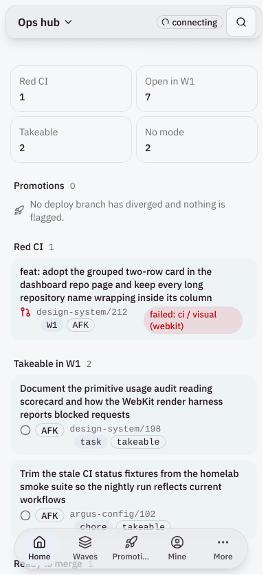 ops-hub: no title, up to 6 chips a row | 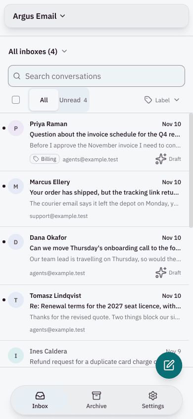 email: seven sizes, 12.5px rows | 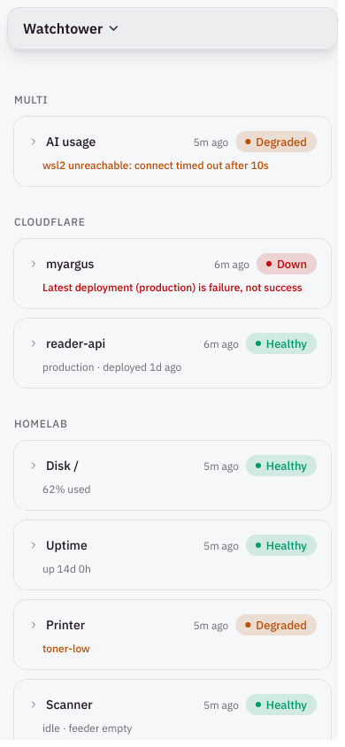 watchtower: state from chart colours |
| 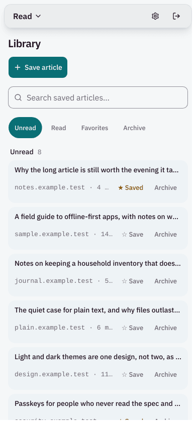 reader: titles cut short | 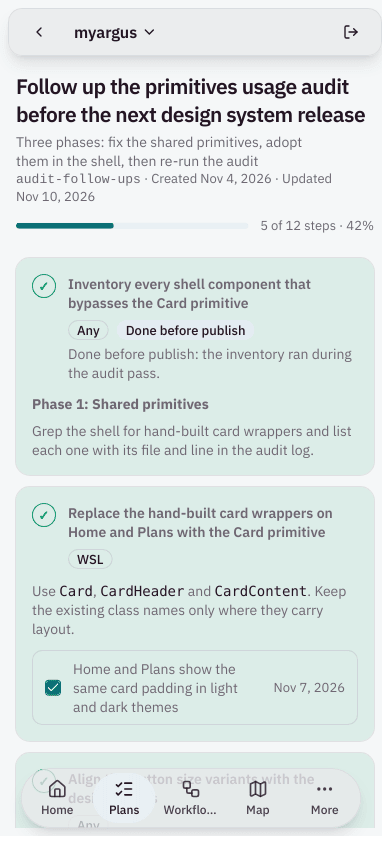 shell: green tint, 25 contrast failures | 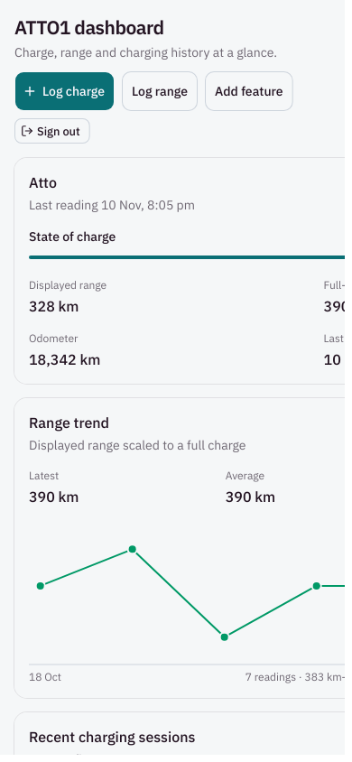 atto1: scrolls sideways |

What the lines that never fail say: no screen puts more than two colours in a row, every list with a goal shows a count, and no screen runs an animation under reduced motion. The registry's defaults are doing that work.

## Data for design-system#207

Proposed scale: type 12/14/16/20/28 at weights 400 and 600; spacing 4/8/12/16/24/32/48; one 8px radius; a pointer-driven density token.

### What the apps declare

Off-scale occurrences in each app's own files:

| App | Type off / all | Weight off / all | Spacing off / all | Radius off / all | All off / all | Off-scale share | Files with an off-scale value / own files |
|---|---|---|---|---|---|---|---|
| argus/email | 48 / 116 | 41 / 57 | 95 / 326 | 32 / 40 | 216 / 539 | 40% | 12 / 69 |
| argus/watchtower | 2 / 15 | 4 / 6 | 3 / 30 | 2 / 3 | 11 / 54 | 20% | 5 / 35 |
| email/email | 48 / 116 | 41 / 57 | 95 / 326 | 32 / 40 | 216 / 539 | 40% | 12 / 69 |
| ops-hub/ops-hub-web | 17 / 144 | 20 / 35 | 59 / 262 | 12 / 16 | 108 / 457 | 24% | 21 / 68 |
| myargus/briefings | 4 / 15 | 4 / 8 | 3 / 23 | 4 / 5 | 15 / 51 | 29% | 4 / 14 |
| myargus/jobs | 6 / 18 | 5 / 9 | 3 / 29 | 6 / 7 | 20 / 63 | 32% | 5 / 16 |
| myargus/knowledge | 11 / 88 | 19 / 19 | 36 / 122 | 16 / 18 | 82 / 247 | 33% | 17 / 63 |
| myargus/reader | 0 / 9 | 1 / 1 | 6 / 37 | 2 / 2 | 9 / 49 | 18% | 5 / 28 |
| myargus/shell | 59 / 92 | 14 / 23 | 25 / 147 | 23 / 23 | 121 / 285 | 42% | 18 / 33 |
| myargus/stockade | 1 / 31 | 6 / 7 | 8 / 90 | 12 / 16 | 27 / 144 | 19% | 9 / 25 |
| homelab/scan-app | 6 / 14 | 2 / 4 | 2 / 22 | 1 / 1 | 11 / 41 | 27% | 1 / 6 |
| quick-capture/web | 0 / 5 | 0 / 1 | 3 / 7 | 0 / 0 | 3 / 13 | 23% | 1 / 4 |
| atto1 | 3 / 15 | 6 / 7 | 3 / 38 | 2 / 2 | 14 / 62 | 23% | 7 / 25 |
| budget/web | 534 / 1870 | 951 / 1106 | 698 / 3625 | 752 / 765 | 2935 / 7366 | 40% | 147 / 240 |
| sparky | 20 / 51 | 10 / 25 | 11 / 70 | 13 / 14 | 54 / 160 | 34% | 9 / 21 |
| slate-reader/server | 0 / 0 | 0 / 0 | 0 / 0 | 0 / 0 | 0 / 0 | n/a | 0 / 9 |
| slate-reader/client | 10 / 22 | 0 / 1 | 12 / 50 | 6 / 6 | 28 / 79 | 35% | 4 / 17 |
| registry v3.24.0 `ui` (baseline) | 37 / 144 | 46 / 53 | 175 / 450 | 89 / 121 | 347 / 768 | 45% | n/a |

All apps together:

| Dimension | On-scale occurrences | Off-scale occurrences | Off-scale values (px×occurrences) |
|---|---|---|---|
| type | 1784 | 721 | 7×1, 8×14, 9×25, 10×210, 11×38, 11.5×1, 12.5×4, 13×107, 13.5×7, 13.6×4, 15×6, 18×96, 18.4×1, 19×1, 21×9, 21.6×1, 24×72, 26×4, 27.2×1, 30×81, 36×29, 48×3, 60×4, 72×2 |
| weight | 226 | 1083 | 500×407, 700×570, 800×7, 900×99 |
| spacing | 3911 | 967 | 0.8×1, 1×3, 1.6×1, 2×206, 4.8×4, 6×317, 9.6×2, 10×99, 12.8×1, 14×49, 17.6×1, 20×175, 22.4×1, 25.6×1, 28×20, 34×1, 36×11, 40×20, 44×3, 56×5, 64×20, 80×8, 96×16, 112×1, 256×1 |
| radius | 35 | 883 | 3×1, 4×101, 6×14, 10×254, 14×393, 18×112, 22×3, 32×5 |

### What migrating costs

A named step (`text-xs`, `rounded-lg`, `font-medium`) can be moved onto the scale by the theme with no edit in the app. A literal, and every off-scale spacing class, needs an edit in the app's source.

| App | Off-scale type: named / literal | Off-scale weight: named / literal | Off-scale radius: named / literal | Off-scale spacing (all need an edit) | Covered by a theme remap | Needs a source edit |
|---|---|---|---|---|---|---|
| argus/email | 1 / 47 | 41 / 0 | 32 / 0 | 95 | 74 | 142 |
| argus/watchtower | 1 / 1 | 4 / 0 | 2 / 0 | 3 | 7 | 4 |
| email/email | 1 / 47 | 41 / 0 | 32 / 0 | 95 | 74 | 142 |
| ops-hub/ops-hub-web | 15 / 2 | 20 / 0 | 12 / 0 | 59 | 47 | 61 |
| myargus/briefings | 3 / 1 | 4 / 0 | 4 / 0 | 3 | 11 | 4 |
| myargus/jobs | 5 / 1 | 5 / 0 | 6 / 0 | 3 | 16 | 4 |
| myargus/knowledge | 0 / 11 | 19 / 0 | 16 / 0 | 36 | 35 | 47 |
| myargus/reader | 0 / 0 | 1 / 0 | 2 / 0 | 6 | 3 | 6 |
| myargus/shell | 50 / 9 | 14 / 0 | 21 / 2 | 25 | 85 | 36 |
| myargus/stockade | 1 / 0 | 6 / 0 | 12 / 0 | 8 | 19 | 8 |
| homelab/scan-app | 6 / 0 | 2 / 0 | 1 / 0 | 2 | 9 | 2 |
| quick-capture/web | 0 / 0 | 0 / 0 | 0 / 0 | 3 | 0 | 3 |
| atto1 | 3 / 0 | 6 / 0 | 2 / 0 | 3 | 11 | 3 |
| budget/web | 268 / 266 | 951 / 0 | 746 / 6 | 698 | 1965 | 970 |
| sparky | 20 / 0 | 10 / 0 | 13 / 0 | 11 | 43 | 11 |
| slate-reader/server | 0 / 0 | 0 / 0 | 0 / 0 | 0 | 0 | 0 |
| slate-reader/client | 3 / 7 | 0 / 0 | 4 / 2 | 12 | 7 | 21 |

Reading it:

- **Weight is the widest gap.** `font-medium` (500) is 407 of the apps' 1,309 weight declarations and 46 of the registry's own 53. It is always a named step, so an opt-in theme can remap it; nothing needs hand-editing.
- **Radius is nearly all remap.** The registry's `rounded-lg` is 10px and `rounded-xl` 14px; an opt-in `--radius: 8px` with flat steps covers all but 10 of the 883 off-scale uses (6 literals in budget, 4 elsewhere).
- **Type splits.** 13px (`text-xs`) and 21px (`text-xl`) remap. The edits are arbitrary sizes: email 47, budget 266, knowledge 11, shell 9.
- **Spacing is the real cost.** Half steps cannot be remapped: 6px (317 uses), 2px (206), 20px (175), 10px (99), 14px (49). Outside budget that is 269 edits, 95 of them in email.
- Whole-app totals outside budget: 367 values covered by a remap, 352 that need an edit. budget alone: 1,965 and 970.

### What the renders add

1. **`IssueRow` has no adopter.** `issue-row`, `grouped-list` and `filter-builder` are in no app. Every list row in every app is `card-list` (7 apps, 27 importing files) or hand-built: email `ThreadList.tsx:452` `ThreadRow` (112 to 117px, 12.5 to 13px text, three weights), ops-hub `backlog-row.tsx:36` on `CardListItem`, stockade and reader on `CardListItem`, scan-app `App.tsx:361`, atto1 `recent-sessions-card.tsx:45`. The full list is report.md section 7, "List rows". Row props that ship only on `IssueRow` change no screen.
2. **Row heights on an iPhone today** (scorecard.md section 4): 34 to 61px on ops-hub's dashboard, 107 to 218px on its home, 112 to 117px in email, 44px in settings lists, 110px in sparky's bills. There is no shared row.
3. **Weight inversion is real on desktop, not on a phone.** The registry's sample fails `headingOutweighsRowsDesktop` (row title 600, group heading 500) and passes on a phone, because `IssueRow` drops its title to 13px/500 below `sm` (`issue-row.tsx:99`). In the apps only shell fails it (step titles at 700).
4. **The proposed scale, rendered and scored** (`screens/ds-sample`): it fixes the inversion, the 32px native select and the sub-16px inputs. It still fails two lines: four sizes in the first viewport (28/16/14/12), and body text at 14px.

### Proposed changes to the scale (for the comment on #207; nothing is implemented here)

1. **Make type follow the pointer, like density.** Body and row titles 14px under a fine pointer and 16px under a coarse one; metadata 12px and 14px. One token pair, set in the same `pointer: coarse` block as the padding. The sample under `primitives-usage/proposed/` does this and passes `reading.bodyText` on four of five screens.
2. **Page title 20px on a phone, 28px on a desktop.** 28px wraps a title like "Adopt the audit's type, spacing and density scale" to four lines at 390px.
3. **Three sizes a screen, not five.** With rule 1, a phone screen needs title 20, body 16, metadata 14 (or 12). The sample's detail, plan and empty screens draw exactly three (20/16/12).
4. **Aim the row work at `card-list`,** or make `IssueRow` the row `card-list` draws. Otherwise it reaches no consumer.
5. **Ship the weight and radius remaps first.** They are free: 407 weight uses and 883 radius uses move with no app edit.
6. **Keep the lint, and add the stale-copy check** ([design-system/211](https://github.com/deanjstone/design-system/issues/211)): a scale that ships in v3.25 reaches no app whose copies stay at v3.9.

## Unused primitives

In no app (31 of 66): `accordion`, `alert`, `aspect-ratio`, `attachment`, `avatar`, `breadcrumb`, `button-group`, `calendar`, `carousel`, `chart`, `code-block`, `combobox`, `context-menu`, `data-table`, `date-picker`, `dropdown-menu`, `hover-card`, `input-otp`, `kbd`, `link-pill`, `menubar`, `native-select`, `navigation-menu`, `pagination`, `questionnaire`, `radio-group`, `resizable`, `scroll-area`, `sidebar`, `slider`, `trace`. `avatar`, `dropdown-menu`, `scroll-area` and `slider` exist in budget as its Radix fork only.

Installed but imported by no app code, only by other registry files: `popover` (11 apps) and `sheet` (11 apps), both pulled in by `app-shell`. Present and imported by nothing at all: `badge` in briefings and reader, `dialog` and `tabs` in atto1.

A suggested split, for the owner to decide ([design-system/212](https://github.com/deanjstone/design-system/issues/212)):

- **Promote** (apps work around them): `alert`, `native-select`, `kbd` (email hand-builds one).
- **Keep** (one consumer is coming or the item is the registry's own demo surface): `chart`, `data-table`, `code-block`, `trace`, `attachment`, `questionnaire`, `link-pill`, `dropdown-menu`, `avatar`, `scroll-area`, `slider`, `sidebar` (budget's migration needs the last five).
- **Candidates to retire in the next major**: `aspect-ratio`, `breadcrumb`, `button-group`, `calendar`, `carousel`, `combobox`, `context-menu`, `date-picker`, `hover-card`, `input-otp`, `menubar`, `navigation-menu`, `pagination`, `radio-group`, `resizable`, `accordion`.

## Missing primitives

Patterns built by hand in two or more apps, with each instance:

| Pattern | Instances |
|---|---|
| Stat tile: a label over one large number | ops-hub `views/home.tsx:173` (`Tiles`), atto1 `src/components/dashboard/vehicle-status-card.tsx:12` (`Stat`), sparky `src/app/screens/Home.tsx:10` (`Tile`), budget `budget-analysis-dashboard.tsx:1559` (`MetricCard`) and `plan/fire-gameplan.tsx:575` (`NumberStat`) |
| Relative time | watchtower `src/lib/cards/units.ts:27`, ops-hub `src/lib/format.ts:11`, knowledge `src/lib/live-notes-status.ts:53`, budget `notification-bell.tsx:43` and `pages/notifications/index.tsx:35` |
| Loading and error notice | briefings `src/components/Notice.tsx:4,14`, jobs `src/components/Notice.tsx:5,23`, shell `src/components/plans/PlansNotice.tsx:30,41`, ops-hub `views/dashboard.tsx:45` and `views/load-error.tsx:6`, knowledge `LiveNoteParts.tsx:31` |
| Tinted notice or banner (what `alert` is for) | ops-hub `promotion-parts.tsx:44`, knowledge `OfflineBanner.tsx:2`, reader `OfflineBanner.tsx:3`, email `SessionExpiredBanner.tsx:7`, budget `demo-banner.tsx:1` |
| Status badge wrapper | ops-hub `promotion-parts.tsx:32`, knowledge `LiveNoteParts.tsx:16`, watchtower `StatusPill.tsx:16`, jobs `RolesTable.tsx:35`, stockade `Products.tsx:49`, reader `LabelBadge.tsx:12` |
| Copy button | ops-hub `promotion-parts.tsx:57`, email `CopyField.tsx:3` |
| Markdown renderer | ops-hub `components/markdown.tsx:86` (`react-markdown`), briefings `lib/markdown.tsx:106` (own), slate-reader server (`marked`) |

Tracked for a decision in [design-system/214](https://github.com/deanjstone/design-system/issues/214). The status badge wrappers mostly use `Badge` correctly; watchtower is the one that picks its own colours.

## Recommendations

Ranked by reading impact on an iPhone, then on a desktop, then by effort. Each has an issue in the repo that owns the fix.

| # | Problem (scorecard lines) | Change, and at what level | Fixes | Cost | Passes afterwards | Issue |
|---|---|---|---|---|---|---|
| 1 | Body under 16px on 23 screens; more than 3 sizes on 22 (`reading.bodyText`, `hierarchy.fontSizes`) | Token, opt-in: type follows the pointer, in the #207 scale | every consumer that opts in | remap in the theme; 352 source edits outside budget, 142 of them in email | `reading.bodyText`, `hierarchy.fontSizes` | comment on [design-system/207](https://github.com/deanjstone/design-system/issues/207) |
| 2 | Text cut short on 12 screens; missing wrap and 16px input fixes (`clutter.nothingCutOff`, `action.inputText`) | App: re-pull stale copies. Registry: `design-check` reports copies older than the pin | six myargus apps, email, watchtower, ops-hub, and the three v3.1.0 apps | a re-pull per app; one script step | `clutter.nothingCutOff` | [myargus/514](https://github.com/deanjstone/myargus/issues/514), [design-system/211](https://github.com/deanjstone/design-system/issues/211) |
| 3 | No page title on 7 screens (`hierarchy.pageTitleVisible`, `oneLargest`) | Registry primitive, opt-in: `app-shell` shows the page title on a phone | ops-hub, email, jobs, watchtower, knowledge | one prop per app | `hierarchy.pageTitleVisible` | [design-system/208](https://github.com/deanjstone/design-system/issues/208) |
| 4 | State off the tokens, contrast failures on 12 screens (`state.statusFromTokens`, `reading.contrast`, `state.moreThanColour`) | Registry: `alert` status variants, the dark destructive wash; DESIGN.md rule. Apps: watchtower, shell, atto1 | watchtower, shell, atto1, and every dark destructive badge | small in the registry; one component each in the apps | `state.statusFromTokens`, `reading.contrast` | [design-system/210](https://github.com/deanjstone/design-system/issues/210), [argus/1194](https://github.com/deanjstone/argus/issues/1194), [myargus/515](https://github.com/deanjstone/myargus/issues/515), [atto1/102](https://github.com/deanjstone/atto1/issues/102) |
| 5 | Tap targets under 44px on 11 screens (`action.tapTargets`) | Registry: add `toggle-group` to the coarse-pointer floor. Apps: icon links | ops-hub (7 controls), jobs (12), reader, scan-app, sparky | one CSS rule and a gate entry | `action.tapTargets` | [design-system/209](https://github.com/deanjstone/design-system/issues/209), [myargus/514](https://github.com/deanjstone/myargus/issues/514) |
| 6 | Up to 6 chips a row; the issue text below the controls; 79 to 113ch lines (`clutter.chipsPerRow`, `reading.lineLength`) | App-level, with a DESIGN.md rule: one chip a row, text before controls, 65ch | ops-hub | two views | `clutter.chipsPerRow`, `reading.lineLength` | [ops-hub/18](https://github.com/deanjstone/ops-hub/issues/18) |
| 7 | Primary action out of thumb reach on 4 of 5 screens (`action.primaryInThumbZone`) | Registry primitive, opt-in: a primary-action slot drawn above the tab bar on a coarse pointer | stockade, atto1, scan-app | larger: a new slot and its geometry | `action.primaryInThumbZone` | [design-system/213](https://github.com/deanjstone/design-system/issues/213) |
| 8 | atto1 scrolls 295px sideways (`reading.noSidewaysScroll`) | App fix | atto1 | small | `reading.noSidewaysScroll` | [atto1/102](https://github.com/deanjstone/atto1/issues/102) |
| 9 | 31 primitives in no app | Decision: keep, promote or retire | the registry's upkeep | owner's call | n/a | [design-system/212](https://github.com/deanjstone/design-system/issues/212) |
| 10 | Seven patterns rebuilt in several apps | Decision: which become registry items | 2 to 6 apps each | owner's call | n/a | [design-system/214](https://github.com/deanjstone/design-system/issues/214) |

Not a design finding, but found by the harness and filed: email's inbox requests `unavatar.io/email/<address>` for every correspondent ([email/3](https://github.com/deanjstone/email/issues/3)).

### Before and after

Five sample screens, built the way `hierarchy-density/proposed.tsx` is: plain elements and `pu-` classes in `primitives-usage/proposed/proposed.css`, colour from twelve existing theme tokens, no registry component used or changed. Rendered and scored by the same harness (`screens/proposed`).

| Today | Proposed | What changed, and the lines it now passes |
|---|---|---|
|  | 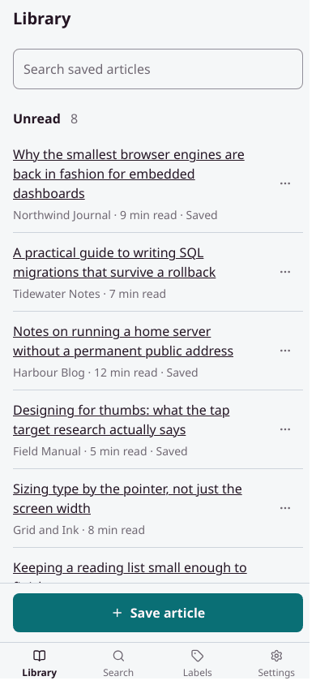 | Recommendations 1, 2, 7. Titles wrap, in 16px. One line of metadata, one control a row. A page title. The action is above the tab bar. Passes `nothingCutOff`, `bodyText`, `tapTargets`, `primaryInThumbZone` |
|  | 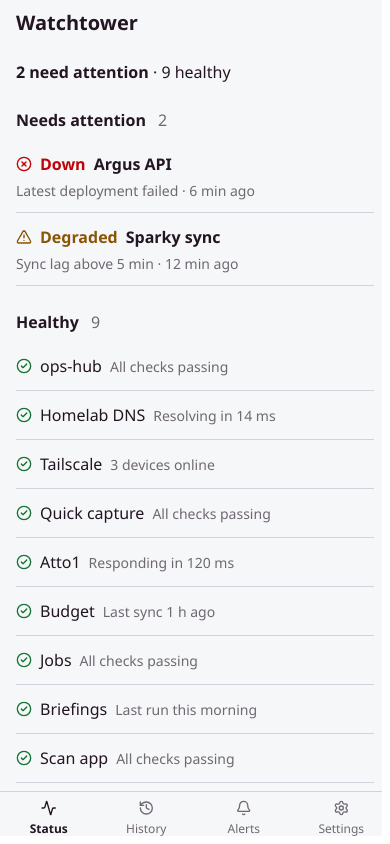 | Recommendation 4. State is an icon and a word in a status token, no tint. What needs attention comes first, with a count. Passes `statusFromTokens`, `contrast`, `pageTitleVisible` |
| 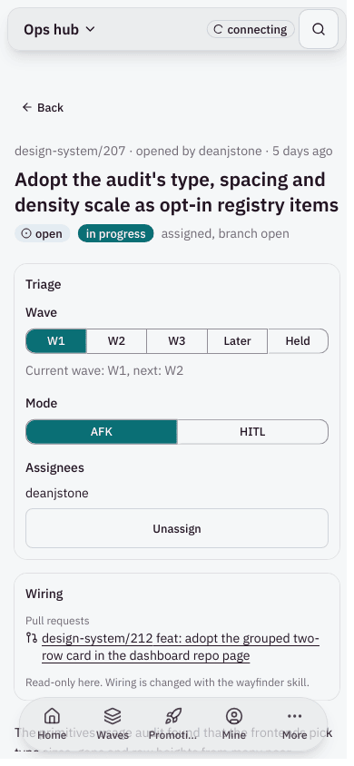 | 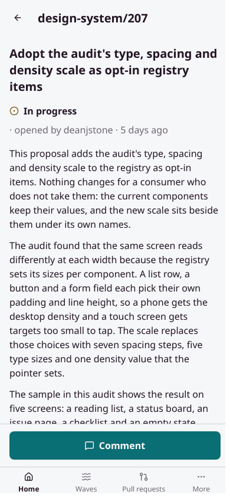 | Recommendations 3, 5, 6. A title, then the text, then Triage behind a disclosure with 44px segments. Three sizes. Passes `pageTitleVisible`, `fontSizes`, `tapTargets`, `interactiveCount` |
|  | 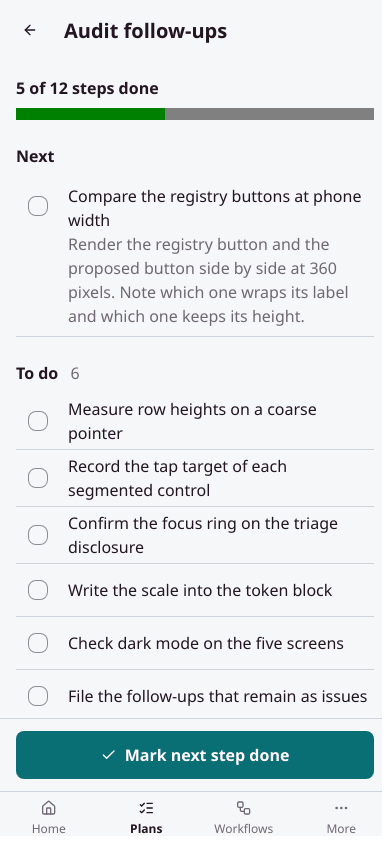 | Recommendation 4. Progress in words and a bar, the next step in full, done steps muted with a check and no tint. Passes `contrast`, `chipsPerRow`, `headingOutweighsRows` |
| 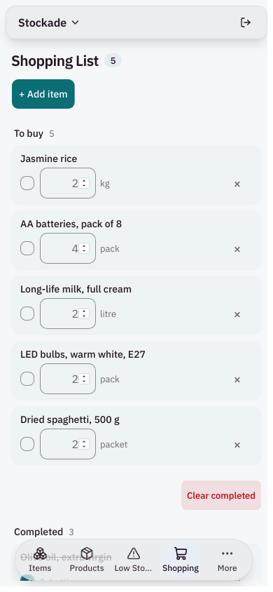 | 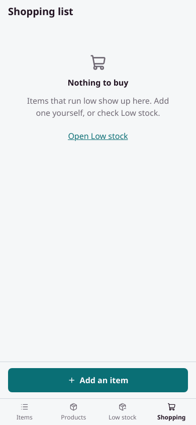 | An empty state that says what to do next, with the action in reach. Passes `emptySaysNext`, `primaryInThumbZone` |

Desktop and dark renders of each are beside them (`*-desktop-light.png`, `*-iphone-dark.png`).

The samples' measurements, beside the registry's own sample from the hierarchy audit:

| Screen | Font sizes in the first viewport (px) | Largest text | Body text (px) | h1 on show | Heading weights | Row title weight |
|---|---|---|---|---|---|---|
| ds-sample / current | 21 / 16 / 14 / 13 | 21px ×1 "Issues" | 13 | yes | 600 / 500 | 500 |
| ds-sample / proposed | 28 / 16 / 14 / 12 | 28px ×1 "Issues" | 14 | yes | 600 | 400 |
| proposed / list | 20 / 16 / 14 / 12 | 20px ×1 "Library" | 16 | yes | 600 | 400 |
| proposed / status | 20 / 16 / 14 / 12 | 20px ×1 "Watchtower" | 14 | yes | 600 | 600 |
| proposed / detail | 20 / 16 / 12 | 20px ×2 "design-system/207" | 16 | yes | 600 | 400 |
| proposed / plan | 20 / 16 / 12 | 20px ×1 "Audit follow-ups" | 16 | yes | 600 | 400 |
| proposed / empty | 20 / 16 / 12 | 20px ×1 "Shopping list" | 16 | yes | 600 | no rows |

| Screen | Rows | Row heights (px) | Most chips in a row | Most colours in a row | Texts cut short (in rows) | Controls in the first viewport | Alpha steps | Tap targets under 44px | Inputs under 16px |
|---|---|---|---|---|---|---|---|---|---|
| ds-sample / current | 8 | 44 / 60 | 0 | 1 | 0 (0) | 15 | 1 | 6 of 20 | 2 of 5 |
| ds-sample / proposed | 8 | 57 / 97 | 0 | 2 | 0 (0) | 13 | 0 | 0 of 20 | 0 of 5 |
| proposed / list | 8 | 97 / 121 | 0 | 0 | 0 (0) | 20 | 0 | 0 of 22 | 0 of 1 |
| proposed / status | 11 | 49 / 73 | 0 | 1 | 0 (0) | 4 | 0 | 0 of 4 | 0 of 0 |
| proposed / detail | 6 | 48 / 120 / 144 / 216 | 0 | 0 | 0 (0) | 6 | 0 | 0 of 14 | 0 of 0 |
| proposed / plan | 11 | 44 / 53 / 57 | 0 | 0 | 0 (0) | 13 | 0 | 0 of 13 | 0 of 0 |
| proposed / empty | 0 | none | 0 | 0 | 0 (0) | 6 | 0 | 0 of 6 | 0 of 0 |

What the samples still fail, stated plainly: the list and status screens draw four sizes (20/16/14/12), one more than the rule; the list has 20 controls in the first viewport, because one "More" button a row is still a control a row; the status screen's commonest text is its 14px detail lines; the plan screen's paragraph runs 79 characters on a desktop.

## ADHD reading principles (proposed text for DESIGN.md; not edited in this change)

Each rule is one the scorecard checks. Sizes are CSS pixels on a 390px-wide iPhone unless a rule says otherwise.

1. **One title.** Every screen shows one `h1` in the first viewport, and it is the largest text on the screen by at least 1.2 times. The app name is not the title.
2. **Three sizes.** No more than three font sizes in one viewport: title, body, metadata.
3. **Headings outrank their items.** A group heading is never lighter than the row titles under it. Row titles are regular weight; weight is for headings and for the one thing in a row that needs action.
4. **Body is 16px under a coarse pointer.** Row titles, paragraphs, buttons and inputs. Inputs are 16px on every pointer, so iOS does not zoom.
5. **Nothing is cut short.** Text wraps. `truncate` and line clamps are for one-line navigation only (design-system#205).
6. **One chip a row, two colours a row.** Everything else in a row is one line of plain metadata. No card inside a card.
7. **At most 15 controls in a viewport.** Row actions beyond the first go behind one "More" control or onto the detail page.
8. **The next action is in reach.** A screen's primary action is visible without scrolling and sits in the bottom 40% of the screen or in a bar fixed to the bottom, clear of the safe area. Every target is at least 44 by 44.
9. **State is an icon and a word.** In `--success`, `--warning` or `--critical`, never a chart colour and never colour alone. A date is grey until it is overdue.
10. **Lists with a goal show the count.** "5 of 12 done", in the heading or beside it. What needs attention comes first.
11. **An empty state says what to do next,** with a control that does it.
12. **Read at 45 to 75 characters a line on a desktop,** and at AA contrast in both themes. No sideways scroll at 390 or 320.

## Benchmark notes

For comparison only; none is the reason for a recommendation. Read 12 Nov 2026 through `gh api`, README and component level.

| Source | What it shows | Bearing on this audit |
|---|---|---|
| `ln-dev7/circle` (4,760 stars, Radix, Tailwind 4) | Issue row `h-11`, title `text-xs sm:text-sm font-medium sm:font-semibold`, metadata `text-xs text-muted-foreground` (`components/common/issues/issue-line.tsx:29-71`); group header `h-10`, tinted, `text-sm font-medium` (`group-issues.tsx:53-73`). Buttons default `h-9` | The source of `IssueRow` has the same weight inversion on desktop (row title semibold, group heading medium) and the same 12px phone title. The registry inherited both |
| `assistant-ui/assistant-ui` (13,075, Base UI by default) | Composer input `min-h-11 … text-[15px]` with no pointer gate (`elements/composer.tsx:398`) | A 44px default rather than a coarse-pointer override: design-system#201 R2's direction |
| `shadcndashboard/shadcndashboard` (517, `base-nova`) | Same stack as ours: `h-8` buttons, `--radius: 8px` with -4/-2/0/+4 steps, no `pointer: coarse` rule | Our coarse-pointer floor is ahead of the nearest peer; our radius is 2px larger than its base |
| `nextlevelbuilder/ui-ux-pro-max-skill` (148,236, rule data) | "Min size 44×44px, 8px+ spacing"; "Base 16px, Line-height 1.5"; font scale "12 14 16 18 24 32"; weights 400, 500, 600 to 700 | Agrees with the 44px and 16px rules here; it keeps 500 for labels, which #207 drops |
| `benjitaylor/skills`, `stageshow` (the skill in the shannholmberg post; 3,113) | "hierarchy from spacing and one weight step"; "Row padding is 12px, 8px for a dense list"; "status colors mean status"; "nothing under 10px on the phone"; radii 6/8/10/12; "11 to 15px UI text" (`references/craft.md:44-105`, `verify.md:46`) | Agrees with #207 on two weights and on 8/12 padding, and with rule 9 here. It is for product stills, not app UI: its 11 to 15px text and 26px rows are below this audit's phone rules, and it has no touch-target rule |
| `magicuidesign/magicui`, `theswerd/brainless`, `htmlstreamofficial/preline`, `themesberg/flowbite`, `mrcaidev/tailwindcss-radix-colors` | Effects, terminal-styled chat parts, and two general libraries. Flowbite and Preline ship `stepper`, `timeline`, `rating`, `file-input`, `clipboard`, `banner` | Of the things they have and we lack, only a copy control and a banner match something two of our apps built. None has a stat tile under that name |
| rauchg on DESIGN.md (31 Aug 2026), with the Vercel post it links | Vercel's `design.md` is prose for agents: a priority order, a four-pass workflow, a "reject generated-design reflexes" list; almost no numbers | Our DESIGN.md follows the other spec (`google-labs-code/design.md`: token front matter, fixed section order, a linter). It has the numbers and lacks the workflow parts. The principles above are the missing "checkable rules" section; `npx @google/design.md lint` has not been run on ours |

Not read: each library's full type and spacing files, assistant-ui's message row sizes, circle's other `*-line.tsx` rows, and the X posts themselves (their text came from a mirror).

## Open questions

1. **14 or 16px body in the #207 scale?** The reading rule says 16 on an iPhone; #207 says 14. The audit proposes pointer-driven type. The owner decides.
2. **Is "at most three sizes" the right rule?** The #207 scale has five sizes and its sample draws four on one phone screen. Either the rule is four, or metadata and body share a size on a phone.
3. **Is `argus/apps/email` still meant to exist?** It and `email/apps/email` are the same app at different commits. If argus's copy is dead, it should be removed.
4. **Where does `#894e00` come from?** jobs, knowledge and stockade draw one amber element each that is 5 points off `--warning` (`#8a5300`). The audit did not trace it; a stale `badge.tsx` is the likely source `[speculation]`.
5. **Are the fixture screens representative?** Chips a row, row heights and the number of controls depend on the data. The owner's real backlog may carry more labels than the fixtures do.
6. **The render SHAs for scan-app, quick-capture and atto1** were recorded after their worktrees were removed, from `origin/main` at 18:05 AEDT; a push between the build and that read would make them wrong.
7. **`popover` and `sheet` ride along in 11 apps** only because `app-shell` imports them. Whether that weight is wanted is not measured here.
8. **Thresholds of the audit's own** (15 controls, 4 alpha steps, 1.2 times for the largest text) are judgement. They are in `scorecard.mjs` to change.

## Files

- `docs/audits/primitives-usage/README.md`: how to run all of it.
- `collect.mjs`, `measure.mjs`, `report.mjs`, `apps.json`: Part A. `output/report.md`, `output/data.json`.
- `render.mjs`, `scorecard.mjs`, `serve.mjs`, `render-app.sh`, `gate.sh`, `scores.mjs`: Part B. `output/scorecard.md`.
- `screens/<app>/`: `config.json` (the screens and why each was chosen), `mocks.json` and `init.js` (fixtures), `scorecard.json` (raw measurements), screenshots.
- `proposed/`: the five sample screens.
- `test/primitives-usage.test.ts`: pins the Part A parsers.
