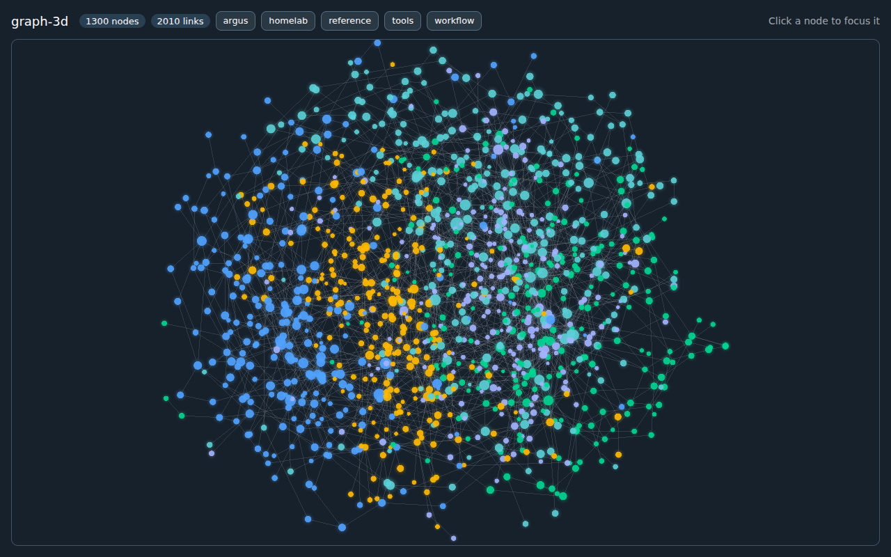
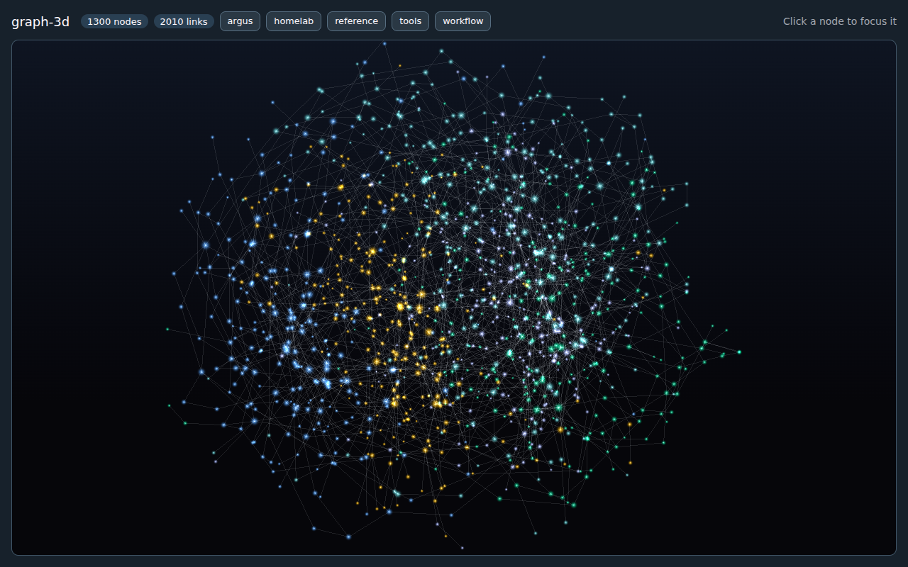
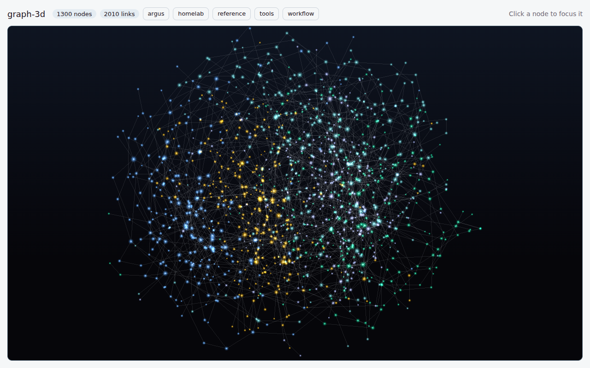
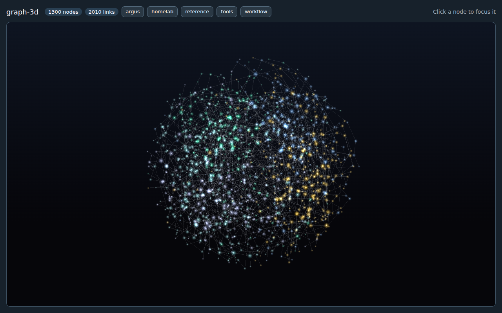
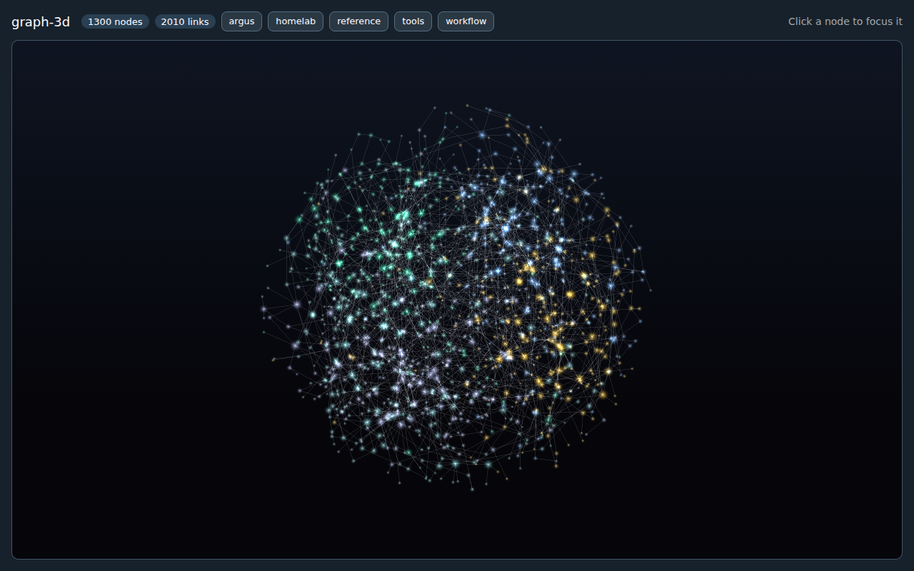
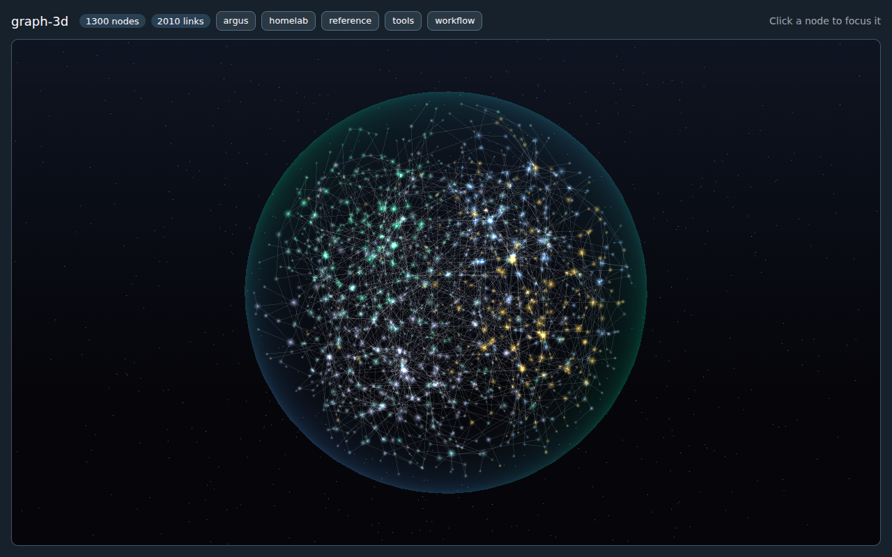
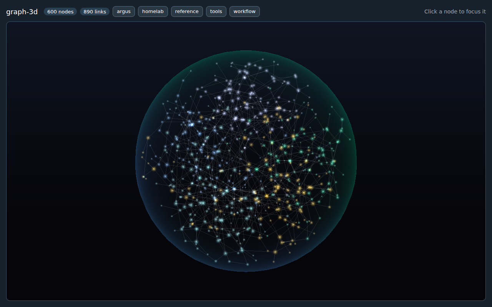
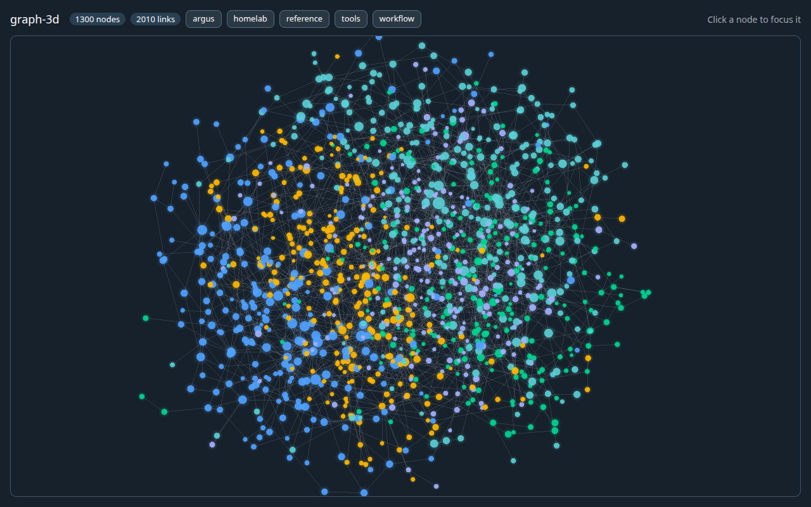
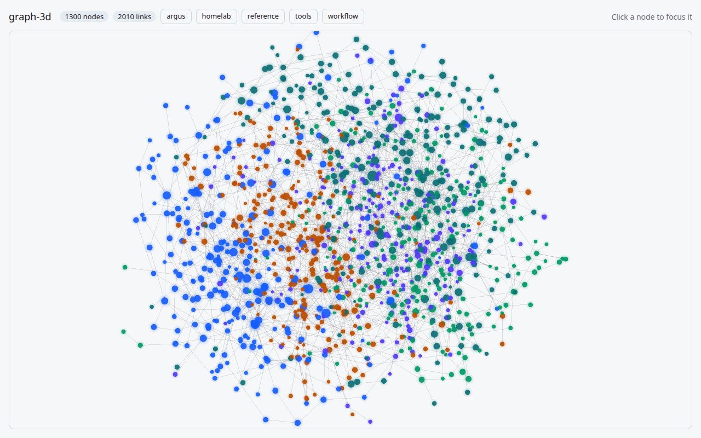

# graph-3d

A 3D force-directed graph that reads as a slowly turning orb of small glowing
nodes joined by faint edges (design-system#169). First consumer: the ops hub
Memory map (argus#1047).

```bash
npx shadcn add deanjstone/design-system/graph-3d
```

```tsx
import { Graph3D } from "@/components/ui/graph-3d"

// Keep these arrays stable (module scope or useMemo): a new array rebuilds the layout.
<Graph3D
  nodes={nodes}            // { id, label, group, size?, heat? }
  links={links}            // { source, target, weight?, kind? }
  highlight={["memory-4"]} // ids; the rest dim, their links light up
  focusId="memory-4"       // glide the camera to a node picked elsewhere (a search result); a jump under reduced motion
  autoRotate               // default true, always off under prefers-reduced-motion
  tone="void"              // the orb look: its own dark gradient, additive soft glow (default: "default")
  onNodeClick={(node) => openMemory(node.id)}
  className="h-[32rem] border bg-card"
/>
```

The component fills its parent (`size-full`, `min-h-64`) and, with the default tone,
paints a transparent canvas, so the surface behind it is yours: `bg-card`, or
`bg-surface-1` for a permanently dark panel.

## Tone

`tone="default"` (the default) is unchanged: normal blending, a hard disc with a halo
and the page's own theme.

`tone="void"` is the orb look, built to sit on a dark surface in light and dark pages
alike:

- **Surface.** The component paints its own gradient, `--surface-0` rising to a deep
  blue mixed from `--chart-5`, so it needs no background class. It carries a `dark`
  class (and copies the page's `data-theme`), so group colours and edges read the dark
  values of the tokens even on a light page.
- **Light.** Nodes and links use additive blending, so overlaps sum toward white. A node
  is a soft point with no edge, a pale core fading out through `pow(1 - smoothstep, 1.8)`.
- **Size.** No 2.6x sprite padding. A sprite is clamped to 3 to 20 CSS px; hubs grow by
  `sqrt(degree)` (the count of kept links), so most nodes are specks and a few bloom.
- **Picking.** The hit radius follows the drawn sprite, not the node's size.
- **Shape.** The layout settles as a spherical shell, not a cloud: see Layout below.

Changing `tone` rebuilds the layout, like changing `nodes`. Try it in the demo with
`?tone=void`.

| Default tone | `tone="void"` |
|---|---|
|  |  |

`tone="void"` on a light page: 

## Heat

`heat` on a node, 0 to 1, sets how much it stands out. It works in both tones and is
optional: a graph with no heat draws exactly as before.

- **Brightness.** `floor + heat * gain`, with a floor of 0.42, so a cold node dims to
  about 40% and a hot one is full. A hovered or highlighted node is always full.
- **Size.** The sprite scales from 0.6x at heat 0 to 1.4x at heat 1 (1.0x at 0.5),
  inside the tone's pixel clamp.
- **Colour.** A cold node keeps its group colour's hue but loses saturation, down to
  30% at heat 0, so the cold majority reads as faint and the hot few carry the colour.
- Values outside 0 to 1 are clamped; a missing or non-finite value means no heat.

Feed it something that is mostly low with a few high: the sample uses
`sqrt(links / most links)`, so a few hubs run hot and most notes stay cool. The demo
draws the same graph without heat at `?heat=0`.

| `tone="void"`, no heat, force cloud | `tone="void"`, heat and shell layout |
|---|---|
|  |  |

## Layout

Under `tone="void"` the layout is a sphere. A stronger `forceRadial` was tried first and
was not enough: on the 1,300-node sample, even at strength 1 nodes ended between 0.55R
and 1.31R with the spread still 12% of the mean radius. So void swaps the radial force
for a shell force that ranks the nodes by distance from the centre and aims each at a
radius between 0.4R and 1.0R, spread evenly by volume, and the settled layout is
snapped onto those radii. The force is strong enough (4x) that the snap moves a node
about 0.06R on average, so nothing visibly jumps. Each node keeps its direction from
the centre, so the clusters the links formed stay where they are; only the spacing is
regularised. The default tone keeps its radial-force cloud.

## Atmosphere and motion

`tone="void"` also draws a glass shell and some dust, and the orb moves. None of it
exists under `tone="default"`.

- **Membrane.** A back-faced sphere at 1.04R, additive, lit only at its rim (a fresnel
  term, `pow(1 - |n.v|, 2.4)`) with a peak alpha of 0.3. Its tint drifts slowly between
  `--chart-5` and `--chart-2`, read from the tokens, so it follows the theme. It gives
  the orb a silhouette.
- **Motes.** 1,000 additive specks of about 2.6 CSS px between 1.15R and 2.25R, spread
  evenly by volume, each wandering a few percent of R on its own phase. The field is
  seeded, so rebuilding the graph does not reshuffle it. They carry no data and are never
  picked.
- **Breathing.** The whole orb scales by two sines that do not line up, within 1%, and
  each node pulses to as low as 60% of its brightness on its own phase, so no two
  pulse in step.
- **Precession.** In place of OrbitControls' fixed-axis spin, the orb turns about its
  vertical axis while its pitch tips to and fro within 0.2 rad on a slower cycle, so the
  view circles from changing angles. It follows the `autoRotate` prop; breathing, pulse
  and drift do not.
- **Holds still when touched.** Motion stops (within about a quarter of a second) while
  you drag, zoom or hover a node, and after you let go it waits 8 seconds and then eases
  back over a couple of seconds. Clicking a node to focus it counts as a touch.
- **Reduced motion.** `prefers-reduced-motion: reduce` turns off the motes and all
  motion: no breathing, pulse, drift or precession. The membrane stays, because it is
  still, and the first thing painted is the settled graph.
- **Cost.** Draw calls stay at 3, counted per frame in a real browser: the motes share
  the nodes' `Points` object (an attribute marks them and gives their pixel size), the
  faint and active links share one `LineSegments` (a per-vertex flag picks the brighter
  look), and the membrane is the third. Before this, the nodes, the faint links and a
  separate active-links layer were the three.

| Before: `tone="void"`, heat and shell layout | After: membrane, motes and motion |
|---|---|
|  |  |

Under reduced motion: 

## Behaviour

- **Orbit, zoom, hover, click.** Drag to orbit, wheel or pinch to zoom, hover for a
  label tooltip, click to glide the camera to the node and call `onNodeClick` with
  your own node object. Auto-rotate pauses while a node is hovered.
- **Colour comes from tokens.** Each group takes `--chart-1` to `--chart-5` in
  sorted order, wrapping after five; edges use `--muted-foreground`, active edges
  `--foreground`. Pass `groupTokens={{ risk: "--destructive" }}` to pin a group to
  another token. Light, dark and every named theme work because the engine
  re-reads the tokens when the `html` element's class or attributes change.
- **Reduced motion.** Heat and the shell layout add no motion of their own: heat is
  static, and the snap happens before the first frame when the layout is computed
  unseen. Void's motes and motion are off (see Atmosphere and motion). Under `prefers-reduced-motion: reduce` nothing rotates, the
  camera jumps instead of gliding, damping is off, and the layout is computed
  unseen so the first thing painted is the settled graph. The page then draws
  nothing until you interact. The preference is read live: flipping it while the
  graph is mounted rebuilds it in the quiet mode.
- **Fallback.** Without WebGL the component renders a short message
  (`role="status"`) and logs the cause; the rest of the page is unaffected.

## Why three.js and d3-force-3d, not 3d-force-graph

`3d-force-graph` (and `react-force-graph-3d`) build one `Mesh` per node and one
object per link. At 1,300 nodes and 2,000 to 4,000 links that is thousands of draw
calls, which is what the 60fps goal rules out. Here the layout is
`d3-force-3d` (Barnes-Hut many-body, so a tick is near-linear) and drawing is two
draw calls: one `Points` object with a glow shader for the nodes (the void tone's dust
rides in it too) and one `LineSegments` for the edges (the void tone adds the membrane
as a third). Picking projects the nodes to the screen instead of
raycasting sprites. It costs roughly 400 lines we own, but no per-node scene graph
and no dependency on a wrapper's release cadence.

## Bundle

`graph-3d.tsx` is small. `three` and `d3-force-3d` load through a dynamic
`import()` of `graph-3d-engine` the first time a graph mounts, so a bundler splits
them into their own chunk and a page without a graph never pays for them.

## Run the demo and the measurement

```bash
node docs/graph-3d/measure.mjs            # builds, opens one headless tab, prints JSON
node docs/graph-3d/measure.mjs --nodes 600
```

The demo (`docs/graph-3d/demo.tsx`) renders `sampleGraph(1300)`, a seeded graph
shaped like the CONTEXT vault (1,300 nodes, about 2,000 links, five groups). The
script builds it to a temporary directory, serves it for the run, drives one
Chromium tab, then removes everything; it never leaves a server running.
Add `?n=1300&theme=light&rotate=0` to the demo URL to change what it renders.

## Measured at 1,300 nodes and 2,010 links

`node docs/graph-3d/measure.mjs`, headless Chromium, one 1280x800 tab, on the
homelab host (no GPU, so WebGL is SwiftShader software rendering):

| | Result |
|---|---|
| Force layout settles in | 9.1 s, drawn live while it settles (the orb forms on screen) |
| Frame rate while settling | 21.6 fps, median frame 50 ms |
| Frame rate, settled and auto-rotating | 23.2 fps, median frame 50 ms |
| Main thread per frame while rotating | 0.57 ms in all tasks, 0.24 ms of it script |
| Hover tooltip, click to focus | works (the sweep finds a node, a click focuses it) |
| `prefers-reduced-motion: reduce` | `data-auto-rotate="false"`, two screenshots 1.5 s apart are byte-identical |

The 22 fps is the software rasteriser, not this code: the page's own work is about
0.6 ms a frame, which leaves room for far more than 60 fps, and a GPU draws three
draw calls of points, lines and a small sphere in well under a millisecond. Treat the frame rate
here as a floor measured without a GPU, and re-measure on the consuming device when
it matters. Screenshots: [dark](../assets/graph-3d-1300-dark.png),
[light](../assets/graph-3d-1300-light.png).



